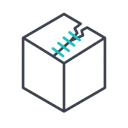
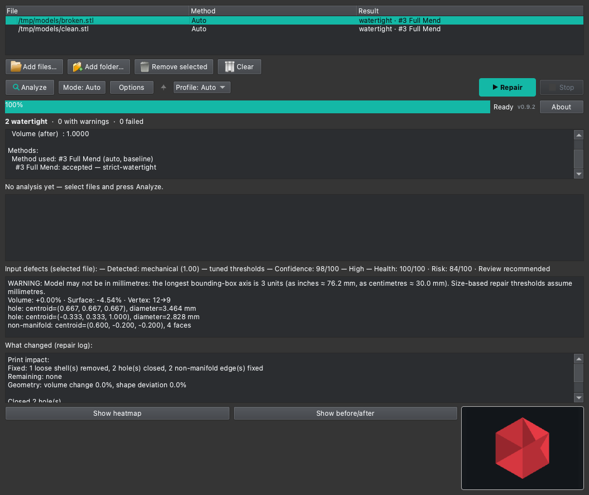

<p align="center">
  
</p>

<h1 align="center">Sutura</h1>

<p align="center">
  <b>Watertight, printable repairs for broken STL, OBJ and 3MF meshes — on Linux and macOS.</b><br>
  Repairs the damage, leaves healthy geometry alone, and keeps the original file untouched.
</p>

<p align="center">
  <a href="https://github.com/Krateian/Sutura/releases/latest"></a>
  <a href="https://github.com/Krateian/Sutura/releases"></a>
  
  
  
  <br>
  <a href="https://github.com/Krateian/Sutura/actions/workflows/ci.yml"></a>
  <a href="https://github.com/Krateian/Sutura/actions/workflows/codeql.yml"></a>
  <a href="https://github.com/Krateian/Sutura/actions/workflows/build-appimage.yml"></a>
  <a href="https://github.com/Krateian/Sutura/actions/workflows/build-macos.yml"></a>
  <br>
  <a href="LICENSE"></a>
  <a href="https://docs.google.com/forms/d/e/1FAIpQLSdqFrO11fjIBACrFwovOKGPpKVdnPcwxW0VRaQfwCqGayfJig/viewform"></a>
  
  
</p>

<p align="center">
  <a href="#install">Install</a> ·
  <a href="#use">Use</a> ·
  <a href="#how-it-works">How it works</a> ·
  <a href="#documentation">Documentation</a> ·
  <a href="CHANGELOG.md">Changelog</a> ·
  <a href="README.tr.md">Türkçe</a>
</p>

---

Linux has no direct equivalent of Windows' right-click *Fix model* (3D Builder,
Netfabb), and Bambu Studio's *Fix model* button does not work on Linux. Sutura
fills that gap: pick a mesh, repair it, and get a repaired copy that slicers
accept — from a GUI, the command line, a file-manager right-click or an
OrcaSlicer plugin.

<p align="center">
  
</p>

## Highlights

- **Repairs only what is broken.** Holes, wrongly joined edges, flipped faces,
  overlapping or self-intersecting parts and loose debris are treated; a clean
  model passes through unchanged.
- **Never worse than the input.** Every repair step is adopted only when its
  result is at least as good as what the repair already had; otherwise it is
  discarded.
- **Honest verdict.** The result is reloaded and re-checked before it is called
  watertight, and a report shows what was fixed, what remains and how much the
  shape moved.
- **Many tools, one button.** Nineteen ranked repair methods sit behind a single
  *Repair* button; the triage engine picks what a model needs.
- **Native and offline.** A Rust core (`sutura_geom`) does the geometry; no
  network access is needed after installation.
- **Fits the workflow.** Dolphin service menu on KDE, Finder Quick Action on
  macOS, an experimental OrcaSlicer plugin, batch repair and multi-object 3MF.

## Install

**Linux** — one line (installs the latest `main`; re-running updates it):

```sh
curl -fsSL https://raw.githubusercontent.com/Krateian/Sutura/main/install.sh | bash
```

A self-contained **AppImage** is attached to every
[release](https://github.com/Krateian/Sutura/releases/latest):

```sh
chmod +x Sutura-x86_64.AppImage && ./Sutura-x86_64.AppImage
```

**macOS** — download `Sutura-vX.Y.Z.dmg` from the
[latest release](https://github.com/Krateian/Sutura/releases/latest) (unsigned:
open it with right-click → *Open* the first time), or install from source:

```sh
git clone https://github.com/Krateian/Sutura.git && cd Sutura && ./install-macos.sh
```

Requirements, the fTetWild tier, updates and uninstalling are covered
in [Install and requirements](docs/guide/install.md).

## Use

```sh
sutura model.stl                 # writes model_fixed.stl
sutura model.3mf -o fixed.3mf    # choose the output name
sutura model.stl --human         # readable report of what was fixed
sutura validate model.stl        # analyse only, change nothing
sutura a.stl b.stl c.3mf         # batch
```

- **GUI:** launch *Sutura* from the application menu or Spotlight, add files
  (or drag and drop) and press **Repair**.
- **KDE Dolphin:** right-click a model → **Repair with Sutura**.
- **macOS Finder:** right-click → *Quick Actions* → **Sutura — Repair**.
- **Last-resort solid engine (experimental):** `--solid-engine cdt|ftetwild`
  chooses the rebuild used when everything else failed (also under Options →
  Repair and inherited by the integrations). The default stays **fTetWild**;
  `cdt` is an experimental exact rebuild that runs after Coaptation and before
  fTetWild, and falls back to fTetWild on failure or timeout. It is slow on
  large meshes for now, so prefer it on smaller parts.

Every option, report field and integration is described in [Usage](docs/guide/usage.md).

## How it works

A broken model is treated like damaged skin: the repair works on the wound and
leaves healthy skin alone. In short:

1. **Hole closing** plugs holes from the inside (*Tamponade*) or follows the
   surrounding surface across them (*Flap*).
2. **Clean-up (Stage 1)** fixes the wiring of the surface — duplicate and
   degenerate triangles, wrongly joined edges, flipped faces — and closes what
   is left.
3. **Deeper steps run only when needed:** *Graft* rebuilds just the damaged
   region, *Coaptation* welds and joins folded or overlapping bodies, and the
   fallback tiers (*Splint*, *Dressing*, fTetWild) handle the hardest cases.
4. **Stage 2** produces one closed, printable solid, and the result is reloaded
   and checked before it is reported.

The full walk-through is in [How Sutura works](docs/guide/how-it-works.md).

## Documentation

| Topic | English | Türkçe |
|---|---|---|
| How Sutura works, step by step | [How it works](docs/guide/how-it-works.md) | [Nasıl çalışır](docs/guide/tr/how-it-works.md) |
| Repair methods, intensity presets and external engines | [Methods](docs/guide/methods.md) | [Yöntemler](docs/guide/tr/methods.md) |
| Install, requirements, updates and removal | [Install](docs/guide/install.md) | [Kurulum](docs/guide/tr/install.md) |
| CLI, GUI, reports, Dolphin, Quick Action, OrcaSlicer | [Usage](docs/guide/usage.md) | [Kullanım](docs/guide/tr/usage.md) |
| Common problems and fixes | [Troubleshooting](docs/guide/troubleshooting.md) | [Sorun giderme](docs/guide/tr/troubleshooting.md) |
| Maturity of each area | [Feature status](docs/guide/feature-status.md) | [Özellik durumu](docs/guide/tr/feature-status.md) |
| Robustness and known limitations | [Limitations](docs/guide/limitations.md) | [Sınırlamalar](docs/guide/tr/limitations.md) |
| Mesh-type detection (mechanical / organic) | [Mesh classifier](docs/guide/mesh-classifier.md) | [Sınıflandırıcı](docs/guide/tr/mesh-classifier.md) |
| Architecture and libraries | [Architecture](docs/guide/architecture.md) | [Mimari](docs/guide/tr/architecture.md) |
| Anonymous usage history (opt-out) | [Privacy](docs/guide/privacy.md) | [Gizlilik](docs/guide/tr/privacy.md) |
| Tests and benchmarks (developers) | [Testing](docs/guide/testing.md) | [Test](docs/guide/tr/testing.md) |
| Feature releases at a glance | [Version history](docs/guide/version-history.md) | [Sürüm geçmişi](docs/guide/tr/version-history.md) |
| Every change in detail | [CHANGELOG.md](CHANGELOG.md) | — |

## A note from the maintainer

Sutura is developed by a single maintainer alongside a full-time role in
aircraft maintenance. Releases do not follow a fixed schedule: work is merged
into `main` continuously and a release is cut when a batch of it is ready, so a
regular release cadence should not be expected. The project is actively
developed; the Linux one-line installer always tracks `main`.

## Contributing

Bug reports, unclear documentation, meshes that will not repair and pull
requests are all welcome — small contributions matter as much as big features.
When reporting a mesh, please include the `sutura <file> --human` output (or the
JSON report), the command that was run and, if known, how the mesh was produced
(slicer, scanner, CAD export). The issue template is in
`.github/ISSUE_TEMPLATE/bug_report.md`; see also [CONTRIBUTING.md](CONTRIBUTING.md).

## Sponsors

If Sutura has saved time or a print,
[development can be sponsored on GitHub](https://github.com/sponsors/Krateian).

## License

Since v0.2.0 Sutura is licensed under the
[PolyForm Noncommercial 1.0.0](LICENSE). Personal, non-commercial use — hobby,
research, education, personal 3D printing — is and will remain free; this is a
permanent commitment. Commercial use requires a separate agreement: fill in the
[Commercial License Request form](https://docs.google.com/forms/d/e/1FAIpQLSdqFrO11fjIBACrFwovOKGPpKVdnPcwxW0VRaQfwCqGayfJig/viewform)
(answers are private). Versions v0.1.0–v0.1.9 remain permanently available under
[Apache 2.0](https://github.com/Krateian/Sutura/blob/v0.1.9/LICENSE).

Why the change: Sutura started as a personal need, and the AI tooling used to
develop it is paid for by the maintainer. Free commercial use would not be fair
to the project. Should the maintainer one day be unable to continue, the plan is
to release Sutura fully open source and hand it to the community.
