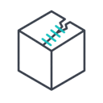
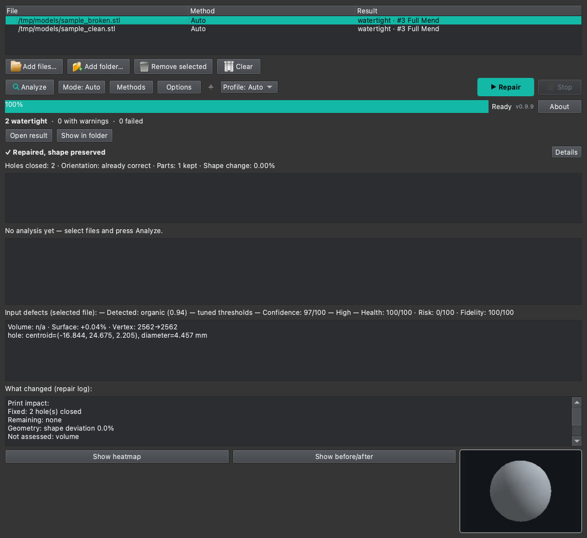

<p align="center">
  
</p>

<h1 align="center">Sutura</h1>

<p align="center">
  <b>Bozuk STL, OBJ ve 3MF mesh'ler için su geçirmez, basılabilir onarım — Linux ve macOS'ta.</b><br>
  Hasarı onarır, sağlam geometriye dokunmaz ve orijinal dosyayı olduğu gibi bırakır.
</p>

<p align="center">
  <a href="https://github.com/Krateian/Sutura/releases/latest"></a>
  <a href="https://github.com/Krateian/Sutura/releases"></a>
  
  
  
  <br>
  <a href="https://github.com/Krateian/Sutura/actions/workflows/ci.yml"></a>
  <a href="https://github.com/Krateian/Sutura/actions/workflows/codeql.yml"></a>
  <a href="https://github.com/Krateian/Sutura/actions/workflows/build-appimage.yml"></a>
  <a href="https://github.com/Krateian/Sutura/actions/workflows/build-macos.yml"></a>
  <br>
  <a href="LICENSE"></a>
  <a href="https://docs.google.com/forms/d/e/1FAIpQLSdqFrO11fjIBACrFwovOKGPpKVdnPcwxW0VRaQfwCqGayfJig/viewform"></a>
  
  
</p>

<p align="center">
  <a href="#kurulum">Kurulum</a> ·
  <a href="#kullanım">Kullanım</a> ·
  <a href="#nasıl-çalışır">Nasıl çalışır</a> ·
  <a href="#belgeler">Belgeler</a> ·
  <a href="CHANGELOG.md">Changelog</a> ·
  <a href="README.md">English</a>
</p>

---

Yaygın tek tıkla onarım yolları yalnızca Windows'ta çalışır: 3D Builder'ın
onarımı ve Bambu Studio'nun *Fix model* özelliği (Microsoft'un Netfabb
hizmetini çağırır) Linux veya macOS'ta kullanılamaz. Sutura bu boşluğu her iki
platformda doldurur: mesh'i seçin, onarın ve dilimleyicilerin kabul ettiği
onarılmış bir kopya alın — GUI'den, komut satırından, dosya yöneticisinde sağ
tıkla ya da bir OrcaSlicer eklentisiyle.

<p align="center">
  
</p>

## Öne çıkanlar

- **Yalnızca bozuk olanı onarır.** Delikler, yanlış birleşmiş kenarlar, ters
  yüzler, üst üste binen ya da kendini kesen parçalar ve kopuk döküntüler
  onarılır; temiz bir model değişmeden geçer.
- **Topoloji kötüleşmez; şekil değişimi raporlanır.** Her onarım adayı,
  yalnızca topolojik kusurlar kötüleşmediğinde (delik veya non-manifold kenar
  sayısı artmaz; birçok katmanda sıfır kusur şartı aranır) ve patlama sınırları
  aşılmadığında benimsenir; aksi halde reddedilir (bkz. ["Daha kötü yapmama" ilkesi neleri kapsar](docs/guide/tr/how-it-works.md#daha-kötü-yapmama-no-worse-ilkesi-neleri-kapsar)).
- **Şekil şeffaflığı.** Ağır hasar modeli yeniden inşa etmeye zorlarsa
  (örneğin fTetWild ile), raporlama amaçlı **Sadakat puanı** yüzeyin nerede ve
  ne kadar değiştiğini açıkça gösterir.
- **Tek ve net hüküm.** Başlık hükmü modelin baskıya hazır olup olmadığını,
  notlar içerip içermediğini veya şeklinin değişip değişmediğini tek satırda
  söyler; Sağlık, Risk ve Sadakat puanları **Ayrıntılar** arkasında sunulur.
- **Çok araç, tek düğme.** On dokuz kayıtlı onarım yöntemi tek bir *Onar*
  düğmesinin arkasındadır; triage motoru etkin olanlar arasından seçer.
- **Yerel ve çevrimdışı.** Geometriyi Rust çekirdeği (`sutura_geom`) yapar;
  kurulumdan sonra internet bağlantısı gerekmez.
- **İş akışına uyar.** KDE'de Dolphin servis menüsü, macOS'ta Finder Quick
  Action, deneysel bir OrcaSlicer eklentisi (2.5.0+ / nightly, ayrıca kurulur),
  toplu onarım ve çok nesneli 3MF.

## Kurulum

**Linux** — tek satır (güncel `main`'i kurar; yeniden çalıştırmak günceller):

```sh
curl -fsSL https://raw.githubusercontent.com/Krateian/Sutura/main/install.sh | bash
```

Kendi içinde tam bir **AppImage** her
[sürüme](https://github.com/Krateian/Sutura/releases/latest) eklenir:

```sh
chmod +x Sutura-x86_64.AppImage && ./Sutura-x86_64.AppImage
```

**macOS** — `Sutura-vX.Y.Z.dmg` dosyasını
[son sürümden](https://github.com/Krateian/Sutura/releases/latest) indirin
(imzasızdır: ilk açılışta sağ tık → *Aç*), ya da kaynaktan kurun:

```sh
git clone https://github.com/Krateian/Sutura.git && cd Sutura && ./install-macos.sh
```

Gereksinimler, fTetWild katmanı, güncelleme ve kaldırma
[Kurulum ve gereksinimler](docs/guide/tr/install.md) sayfasında anlatılır.

## Kullanım

```sh
sutura model.stl                 # model_fixed.stl yazar
sutura model.3mf -o fixed.3mf    # çıktı adını seçer
sutura model.stl --human         # nelerin düzeltildiğine dair okunur rapor
sutura model.stl --no-fidelity   # şekil sadakati skorunu atla (yalnızca rapor)
sutura validate model.stl        # yalnızca analiz, hiçbir şeyi değiştirmez
sutura a.stl b.stl c.3mf         # toplu onarım
```

- **GUI:** *Sutura*'yı uygulama menüsünden ya da Spotlight'tan açın, dosyaları
  ekleyin (veya sürükleyip bırakın) ve **Onar**'a basın.
- **KDE Dolphin:** modele sağ tık → **Sutura ile Onar**.
- **macOS Finder:** sağ tık → *Hızlı Eylemler* → **Sutura — Repair**.
- **Bir şeyler ters giderse:** sert bir çökme, Sutura'nın kullanıcı verisi
  klasörüne sınırlı boyutlu bir `crash.log` yazar; yakalanmamış hatalar ayrıca
  kısa bir diyalog gösterir, yerel bir çökme ise kaydı bir sonraki açılışa
  bırakır. `sutura --diagnostics out.zip` hata bildirimi için temizlenmiş bir
  kopyasını pakete ekler. Kayıt, siz eklemedikçe makinenizden çıkmaz.
  Bkz. [Sorun giderme](docs/guide/tr/troubleshooting.md).
- **3MF boya, dikiş ve destekleri mümkün olduğunca korunur.** Değişmeden kalan
  üçgenlerde kalır; yeni oluşturulan üçgenlere aktarılmaz. Bir onarım bunları
  kaybederse rapor, tutulan / bırakılan / yeni sayılarıyla bunu bildirir.
  Bkz. [Kullanım](docs/guide/tr/usage.md).
- **Ayrı küçük parçalar raporlanır, sessizce değiştirilmez.** Rapor, onarımın
  kaldırdığı küçük bileşenleri (etkin Aşama 1 küçük-parça eşiğinin altında,
  `mincomponentsize`; varsayılan 8 yüz) boyutları ve ana gövdeye uzaklıklarıyla
  listeler ve korunan küçük ayrı parçaları (bilgilendirme amaçlı, hüküm
  değişmez) — hiçbir şey silinmeden. Bkz. [Kullanım](docs/guide/tr/usage.md).
- **Onarım başına tek hüküm.** Hem CLI hem GUI tek bir başlık hükmü gösterir
  (şekil kontrolü katlanmış); tam rapor **Ayrıntılar** arkasında ve İngilizce ile
  Türkçe yerelleştirilmiştir. Bkz. [Kullanım](docs/guide/tr/usage.md).
- **Son çare katı motoru (deneysel):** `--solid-engine cdt|ftetwild` her şey
  başarısız olduğunda kullanılacak yeniden inşayı seçer (Seçenekler → Onarım
  altında da; entegrasyonlarca devralınır). Varsayılan **fTetWild** olarak
  kalır; `cdt` Coaptation sonrası ve fTetWild öncesi çalışan deneysel bir kesin
  yeniden inşadır ve başarısız olursa ya da zaman aşımına uğrarsa fTetWild'a
  geçer. Şimdilik yavaştır: birçok modelde, birkaç bin yüzlü olanlarda bile zaman
  sınırı içinde bitmez ve Sutura otomatik olarak fTetWild'a döner. Küçük ya da
  basit modellerde veya orijinal yüzeyin birebir korunmasını istediğinizde
  kullanın.

Tüm seçenekler, rapor alanları ve entegrasyonlar [Kullanım](docs/guide/tr/usage.md)
sayfasındadır.

## Nasıl çalışır

Bozuk bir model hasarlı bir deri gibi ele alınır: onarım yaraya odaklanır,
sağlam deriye dokunmaz. Kısaca:

1. **Delik kapatma**, delikleri içeriden tıkar (*Tamponade*) ya da çevredeki
   yüzeyi takip ederek kapatır (*Flap*). Tamponad, dolduracak iç hacmi olmayan
   ince kabuklarda ve açık yüzeylerde atlanır; bunları Flap kapatır. İnce uzun
   açık borular ve alt kapağı kapalı bardaklar henüz yakalanmaz; tıkaç zararsız
   biçimde reddedilir.
2. **Temizlik (Aşama 1)**, yüzeyin bağlantılarını düzeltir — duplike ve
   dejenere üçgenler, yanlış birleşmiş kenarlar, ters yüzler — ve kalan
   delikleri kapatır.
3. **Daha derin adımlar yalnızca gerektiğinde çalışır:** *Graft* sadece hasarlı
   bölgeyi yeniden kurar, *Coaptation* katlanmış ya da üst üste binmiş gövdeleri
   kaynaklayıp birleştirir, yedek katmanlar (*Splint*, *Dressing*,
   fTetWild) en zor durumları üstlenir.
4. **Aşama 2** kapalı bir mesh'i tek, su geçirmez ve basılabilir bir katı olarak
   yeniden kurar; sonuç raporlanmadan önce yeniden yüklenip kontrol edilir.

Ayrıntılı anlatım [Sutura nasıl çalışır](docs/guide/tr/how-it-works.md) sayfasındadır.

## Belgeler

| Konu | Türkçe | English |
|---|---|---|
| Sutura adım adım nasıl çalışır | [Nasıl çalışır](docs/guide/tr/how-it-works.md) | [How it works](docs/guide/how-it-works.md) |
| Onarım yöntemleri, yoğunluk presetleri ve harici motorlar | [Yöntemler](docs/guide/tr/methods.md) | [Methods](docs/guide/methods.md) |
| Politika dosyası: ayarlanabilir bölümler ve kilitli güvenlik kapıları | [Politika](docs/guide/tr/policy.md) | [Policy](docs/guide/policy.md) |
| Kurulum, gereksinimler, güncelleme ve kaldırma | [Kurulum](docs/guide/tr/install.md) | [Install](docs/guide/install.md) |
| CLI, GUI, raporlar, Dolphin, Quick Action, OrcaSlicer | [Kullanım](docs/guide/tr/usage.md) | [Usage](docs/guide/usage.md) |
| Sık karşılaşılan sorunlar ve çözümleri | [Sorun giderme](docs/guide/tr/troubleshooting.md) | [Troubleshooting](docs/guide/troubleshooting.md) |
| Her alanın olgunluk durumu | [Özellik durumu](docs/guide/tr/feature-status.md) | [Feature status](docs/guide/feature-status.md) |
| Sağlamlık ve bilinen sınırlamalar | [Sınırlamalar](docs/guide/tr/limitations.md) | [Limitations](docs/guide/limitations.md) |
| Mesh türü tespiti (mekanik / organik) | [Sınıflandırıcı](docs/guide/tr/mesh-classifier.md) | [Mesh classifier](docs/guide/mesh-classifier.md) |
| Mimari ve kütüphaneler | [Mimari](docs/guide/tr/architecture.md) | [Architecture](docs/guide/architecture.md) |
| Anonim kullanım geçmişi (kapatılabilir) | [Gizlilik](docs/guide/tr/privacy.md) | [Privacy](docs/guide/privacy.md) |
| Testler ve benchmark (geliştiriciler) | [Test](docs/guide/tr/testing.md) | [Testing](docs/guide/testing.md) |
| Özellik sürümleri tek bakışta | [Sürüm geçmişi](docs/guide/tr/version-history.md) | [Version history](docs/guide/version-history.md) |
| Tüm değişiklikler ayrıntılı | — | [CHANGELOG.md](CHANGELOG.md) |

## Geliştiriciden bir not

Sutura, havacılık bakımında tam zamanlı bir işin yanında tek bir geliştirici
tarafından sürdürülür. Sürümler sabit bir takvime bağlı değildir: çalışmalar
sürekli olarak `main`'e eklenir ve bir grup iş hazır olduğunda sürüm çıkarılır;
bu yüzden düzenli bir sürüm temposu beklenmemelidir. Proje aktif olarak
geliştirilmektedir; Linux tek satırlık kurulum her zaman `main`'i takip eder.

## Katkı

Hata bildirimleri, anlaşılmayan belgeler, onarılamayan mesh'ler ve pull
request'lerin hepsi memnuniyetle karşılanır — küçük katkılar büyük özellikler
kadar değerlidir. Bir mesh bildirirken lütfen `sutura <dosya> --human` çıktısını
(ya da JSON raporunu), çalıştırılan komutu ve biliniyorsa mesh'in nasıl
üretildiğini (dilimleyici, tarayıcı, CAD dışa aktarımı) ekleyin. Hata şablonu
`.github/ISSUE_TEMPLATE/bug_report.md` dosyasındadır; ayrıca
[CONTRIBUTING.md](CONTRIBUTING.md) dosyasına bakın.

Dosya sistemleri arası kaydetme hatasını bildirdiği için @LordKhizir'e (#134) teşekkürler.

## Destekçiler

Sutura zaman ya da bir baskı kazandırdıysa,
[geliştirme GitHub üzerinden desteklenebilir](https://github.com/sponsors/Krateian).

## Lisans

v0.2.0'dan beri Sutura [PolyForm Noncommercial 1.0.0](LICENSE) lisansıyla
dağıtılır. Kişisel, ticari olmayan kullanım — hobi, araştırma, eğitim, kişisel
3D baskı — ücretsizdir ve öyle kalacaktır; bu kalıcı bir taahhüttür. Ticari
kullanım ayrı bir anlaşma gerektirir:
[Ticari Lisans Talep formunu](https://docs.google.com/forms/d/e/1FAIpQLSdqFrO11fjIBACrFwovOKGPpKVdnPcwxW0VRaQfwCqGayfJig/viewform)
doldurun (yanıtlar gizlidir). v0.1.0–v0.1.9 sürümleri kalıcı olarak
[Apache 2.0](https://github.com/Krateian/Sutura/blob/v0.1.9/LICENSE) lisansıyla
kalır.

Değişikliğin nedeni: Sutura kişisel bir ihtiyaçtan doğdu ve geliştirilmesinde
kullanılan yapay zekâ araçlarının maliyeti geliştirici tarafından karşılanıyor.
Ücretsiz ticari kullanım projeye karşı adil olmaz. Geliştirici bir gün devam
edemeyecek duruma gelirse, plan Sutura'yı tamamen açık kaynak yapıp topluluğa
devretmektir.
