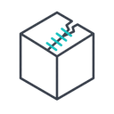
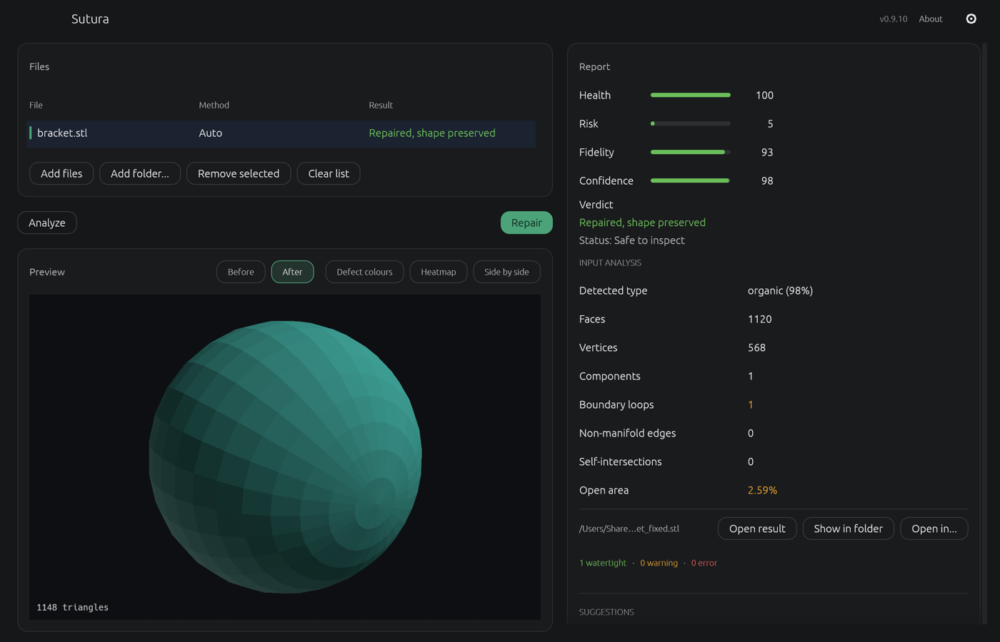

<p align="center">
  
</p>

<h1 align="center">Sutura</h1>

<p align="center">
  <b>Bozuk STL, OBJ ve 3MF mesh'ler için su geçirmez, basılabilir onarım — Linux ve macOS'ta.</b><br>
  Hasarı onarır, sağlam geometriye dokunmaz ve orijinal dosyayı olduğu gibi bırakır.
</p>

<p align="center">
  <a href="https://github.com/Krateian/Sutura/releases/latest"></a>
  <a href="https://github.com/Krateian/Sutura/releases"></a>
  
  
  <br>
  <a href="https://github.com/Krateian/Sutura/actions/workflows/ci.yml"></a>
  <a href="https://github.com/Krateian/Sutura/actions/workflows/build-rust.yml"></a>
  <a href="https://github.com/Krateian/Sutura/actions/workflows/linux-install.yml"></a>
  <a href="https://github.com/Krateian/Sutura/actions/workflows/macos-install.yml"></a>
  <a href="https://github.com/Krateian/Sutura/actions/workflows/codeql.yml"></a>
  <br>
  <a href="LICENSE"></a>
  <a href="https://docs.google.com/forms/d/e/1FAIpQLSdqFrO11fjIBACrFwovOKGPpKVdnPcwxW0VRaQfwCqGayfJig/viewform"></a>
  
  
</p>

<p align="center">
  <a href="#kurulum">Kurulum</a> ·
  <a href="#kullanım">Kullanım</a> ·
  <a href="#nasıl-çalışır">Nasıl çalışır</a> ·
  <a href="#belgeler">Belgeler</a> ·
  <a href="CHANGELOG.md">Changelog</a> ·
  <a href="README.md">English</a>
</p>

---

Yaygın tek tıkla onarım yolları yalnızca Windows'ta çalışır: 3D Builder'ın
onarımı ve Bambu Studio'nun *Fix model* özelliği (Microsoft'un Netfabb
hizmetini çağırır) Linux veya macOS'ta kullanılamaz. Sutura bu boşluğu her iki
platformda doldurur: mesh'i seçin, onarın ve dilimleyicilerin kabul ettiği
onarılmış bir kopya alın — GUI'den, komut satırından, dosya yöneticisinde sağ
tıkla ya da bir OrcaSlicer eklentisiyle.

> **0.9.10'da yeni**
>
> - **Baştan sona Rust.** Paket Python veya PyMeshLab gerektirmez: yerel CLI,
>   yerel egui GUI, Rust geometri çekirdeği, platform başına tek paket.
> - **Kurulumun küçük bir kısmı.** 20–24 MB indirme ve yaklaşık 45–66 MB
>   kurulum; Python 0.9.9 paketinin yaklaşık 195–203 MB indirmesine ve macOS'ta
>   459.5 MB kurulumuna karşı.
> - **Aynı girdi, aynı baytlar.** macOS arm64 ve Linux x86_64 aynı mesh için
>   bayt bayt aynı çıktıyı verir (MD5 eşleşir).
> - **Her şey pakette.** fTetWild pakette gelir; Dolphin ve Finder sağ tık
>   onarımı ekler, OrcaSlicer 2.5.0+ eklentisi kullanılabilir (deneysel).

<p align="center">
  
</p>

## Öne çıkanlar

- **Yalnızca bozuk olanı onarır.** Delikler, yanlış birleşmiş kenarlar, ters
  yüzler, üst üste binen ya da kendini kesen parçalar ve kopuk döküntüler
  onarılır; temiz bir model değişmeden geçer.
- **Topoloji kötüleşmez; şekil değişimi raporlanır.** Her onarım adayı,
  yalnızca topolojik kusurlar kötüleşmediğinde (delik veya non-manifold kenar
  sayısı artmaz; birçok katmanda sıfır kusur şartı aranır) ve patlama sınırları
  aşılmadığında benimsenir; aksi halde reddedilir (bkz. ["Daha kötü yapmama" ilkesi neleri kapsar](docs/guide/tr/how-it-works.md#daha-kötü-yapmama-no-worse-ilkesi-neleri-kapsar)).
- **Şekil şeffaflığı.** Ağır hasar modeli yeniden inşa etmeye zorlarsa
  (örneğin fTetWild ile), raporlama amaçlı **Sadakat puanı** yüzeyin nerede ve
  ne kadar değiştiğini açıkça gösterir. Örtüşen girdi parçalarının iç duvarları
  ayrıca raporlanır ve görünür yüzey hatırlamasından çıkarılır.
- **Tek ve net hüküm.** Başlık hükmü modelin baskıya hazır olup olmadığını,
  notlar içerip içermediğini veya şeklinin değişip değişmediğini tek satırda
  söyler; Sağlık, Risk ve Sadakat puanları **Ayrıntılar** arkasında sunulur.
- **Çok araç, tek düğme.** On dokuz kayıtlı onarım yöntemi tek bir *Onar*
  düğmesinin arkasındadır; triage motoru etkin olanlar arasından seçer.
- **Rust ile yerel ve çevrimdışı.** CLI, GUI ve geometri çekirdeği Rust'tır;
  paket Python veya PyMeshLab gerektirmez ve kurulumdan sonra internet
  istemez.
- **İki ana hedefte aynı baytlar.** macOS arm64 ve Linux x86_64 aynı girdi
  için bayt bayt aynı çıktıyı verir (MD5 eşleşir).
- **İş akışına uyar.** KDE'de Dolphin servis menüsü, macOS'ta Finder Quick
  Action, deneysel bir OrcaSlicer eklentisi (2.5.0+, ayrıca kurulur),
  toplu onarım ve çok nesneli 3MF.

## Kurulum

Sutura yerel bir Rust programıdır: Python, sanal ortam, conda ve PyMeshLab
yoktur. **Linux (x86_64, aarch64)** ve **macOS (Apple Silicon, Intel)** üzerinde
çalışır.

Makineniz için paketi
[sürümler sayfasından](https://github.com/Krateian/Sutura/releases/latest)
indirin, kurulumcuyu paketin yanına koyun ve çalıştırın:

```sh
bash install-rust.sh --from Sutura-rust-v<version>-x86_64.tar.gz    # Linux
bash install-macos-rust.sh --from Sutura-rust-v<version>-arm64.dmg  # macOS
```

Her paket yanında bir `.sha256` taşır ve kurulumcu bunu doğrular. İki
kurulumcu da mimarinizi algılar, bu yüzden yanlış paketi tahmin etmek yerine
reddeder; `--dry-run` neyin yazılacağını yazdırır.

Gereksinimler, bütünlük kontrolü, güncelleme ve kaldırma
[Kurulum ve gereksinimler](docs/guide/tr/install.md) sayfasında anlatılır.

### Python sürümünden geçiş

Bir Python kurulumu yeniden kurulmaz, taşınır: geçmiş ve öğrenme verileriniz
aktarılır, önceki kurulum geri dönebileceğiniz bir yerde saklanır ve yeni sürüm
sağlık kontrolünü geçmeden hiçbir şey silinmez. Bkz.
[Python sürümünden geçiş](MIGRATE.tr.md).

### Python arka ucu (kullanımdan kaldırıldı)

Paket Python gerektirmez. Bir sürüm boyunca eski bir Python kurulumu
`SUTURA_BACKEND=python` veya başlatıcı bayrağı `sutura --backend python` ile
seçilebilir; bayrağı başlatıcı (`~/.local/bin/sutura`) okur, Rust ikilisi kabul
etmez. Tek satırlık bir kullanımdan kaldırma notu basar ve sonraki sürümde
kaldırılır.

## Kullanım

```sh
sutura model.stl                 # model_fixed.stl yazar
sutura model.3mf -o fixed.3mf    # çıktı adını seçer
sutura model.stl --human         # nelerin düzeltildiğine dair okunur rapor
sutura model.stl --no-fidelity   # şekil sadakati skorunu atla (yalnızca rapor)
sutura model.stl --wall-min-thickness 1.5   # 1,5 mm altındaki duvarları kalınlaştır (isteğe bağlı)
sutura validate model.stl        # yalnızca analiz, hiçbir şeyi değiştirmez
sutura a.stl b.stl c.3mf         # toplu onarım
```

Kurulumu yönetmek:

```sh
sutura --check-update   # daha yeni bir sürüm var mı? (yalnızca bildirir)
sutura --update         # kur — önce sorar, varsayılan yanıt hayırdır
sutura --rollback       # en yeni yedeği geri yükle
sutura --whats-new      # son kurulumun sürüm notları, çevrimdışı
```

- **GUI:** uygulama menüsünden veya Spotlight'tan *Sutura*'yı açın, dosya ekleyin
  (veya sürükleyip bırakın) ve **Onar**'a basın.
- **KDE Dolphin:** bir modele sağ tıklayın → **Repair with Sutura**.
- **macOS Finder:** sağ tık → *Quick Actions* → **Sutura — Repair**.
- **Bir şeyler ters giderse:** sert bir çökme, Sutura'nın kullanıcı verisi
  klasöründe sınırlı boyutlu bir `crash.log` bırakır; yakalanmayan hatalar kısa
  bir iletişim penceresi gösterir, yerel çökme ise günlüğü bir sonraki açılışa
  bırakır. `sutura --diagnostics out.zip` temizlenmiş bir kopyayı hata
  bildirimine eklenmek üzere paketler. Günlük, siz eklemedikçe makineden
  çıkmaz. Bkz. [Sorun giderme](docs/guide/tr/troubleshooting.md).
- **3MF boya, dikiş ve destekler mümkün olduğunca korunur.** Değişmeden kalan
  üçgenlerde kalır; yeni oluşturulan üçgenlere hiçbiri atanmaz. Onarım bunları
  kaybettiğinde rapor bunu korunan / düşen / yeni sayılarıyla söyler. Bkz.
  [Kullanım](docs/guide/tr/usage.md).
- **Ayrı küçük parçalar raporlanır, sessizce değiştirilmez.** Rapor, onarımın
  kaldırdığı küçük bileşenleri (etkin Aşama 1 küçük parça eşiğinin altında,
  `mincomponentsize`; varsayılan 8 yüz) boyutları ve ana gövdeye uzaklıklarıyla
  listeler; korunan küçük ayrı parçaları da (bilgilendirme, hüküm değişmez)
  listeler — hiçbir şeyi silmeden. Bkz. [Kullanım](docs/guide/tr/usage.md).
- **Onarım başına tek hüküm.** Hem CLI hem GUI tek bir başlık hükmü gösterir
  (şekil kontrolü dahil); tam rapor **Ayrıntılar** arkasında ve İngilizce ile
  Türkçe olarak sunulur. Bkz. [Kullanım](docs/guide/tr/usage.md).
- **Son çare katı motor (deneysel):** `--solid-engine cdt|ftetwild`, başka her
  şey başarısız olduğunda kullanılan yeniden inşayı seçer (Options → Repair
  altında da vardır ve entegrasyonlara geçer). Varsayılan **fTetWild** olarak
  kalır; `cdt` deneysel ve kesin bir yeniden inşadır, Coaptation'dan sonra ve
  fTetWild'dan önce çalışır, başarısız olur veya zaman aşımına uğrarsa
  fTetWild'a döner. Şimdilik yavaştır: birkaç bin yüzlü modellerde bile zaman
  sınırı içinde bitmez ve Sutura otomatik olarak fTetWild'a döner. Küçük veya
  basit modellerde ya da özgün yüzey tam olarak korunmak istendiğinde kullanın.

## Nasıl çalışır

Bozuk bir model hasarlı bir deri gibi ele alınır: onarım yaraya odaklanır,
sağlam deriye dokunmaz. Kısaca:

1. **Delik kapatma**, delikleri içeriden tıkar (*Tamponade*) ya da çevredeki
   yüzeyi takip ederek kapatır (*Flap*). Tamponad, dolduracak iç hacmi olmayan
   ince kabuklarda ve açık yüzeylerde atlanır; bunları Flap kapatır. İnce uzun
   açık borular ve alt kapağı kapalı bardaklar henüz yakalanmaz; tıkaç zararsız
   biçimde reddedilir.
2. **Temizlik (Aşama 1)**, yüzeyin bağlantılarını düzeltir — duplike ve
   dejenere üçgenler, yanlış birleşmiş kenarlar, ters yüzler — ve kalan
   delikleri kapatır.
3. **Daha derin adımlar yalnızca gerektiğinde çalışır:** *Graft* sadece hasarlı
   bölgeyi yeniden kurar, *Coaptation* katlanmış ya da üst üste binmiş gövdeleri
   kaynaklayıp birleştirir, yedek katmanlar (*Splint*, *Dressing*,
   fTetWild) en zor durumları üstlenir.
4. **Aşama 2** kapalı bir mesh'i tek, su geçirmez ve basılabilir bir katı olarak
   yeniden kurar; sonuç raporlanmadan önce yeniden yüklenip kontrol edilir.

Ayrıntılı anlatım [Sutura nasıl çalışır](docs/guide/tr/how-it-works.md) sayfasındadır.

## Belgeler

| Konu | Türkçe | English |
|---|---|---|
| Sutura adım adım nasıl çalışır | [Nasıl çalışır](docs/guide/tr/how-it-works.md) | [How it works](docs/guide/how-it-works.md) |
| Onarım yöntemleri, yoğunluk presetleri ve harici motorlar | [Yöntemler](docs/guide/tr/methods.md) | [Methods](docs/guide/methods.md) |
| Politika dosyası: ayarlanabilir bölümler ve kilitli güvenlik kapıları | [Politika](docs/guide/tr/policy.md) | [Policy](docs/guide/policy.md) |
| Kurulum, gereksinimler, güncelleme ve kaldırma | [Kurulum](docs/guide/tr/install.md) | [Install](docs/guide/install.md) |
| Python sürümünden geçiş | [MIGRATE.tr.md](MIGRATE.tr.md) | [MIGRATE.md](MIGRATE.md) |
| CLI, GUI, raporlar, Dolphin, Quick Action, OrcaSlicer | [Kullanım](docs/guide/tr/usage.md) | [Usage](docs/guide/usage.md) |
| Sık karşılaşılan sorunlar ve çözümleri | [Sorun giderme](docs/guide/tr/troubleshooting.md) | [Troubleshooting](docs/guide/troubleshooting.md) |
| Her alanın olgunluk durumu | [Özellik durumu](docs/guide/tr/feature-status.md) | [Feature status](docs/guide/feature-status.md) |
| Sağlamlık ve bilinen sınırlamalar | [Sınırlamalar](docs/guide/tr/limitations.md) | [Limitations](docs/guide/limitations.md) |
| Mesh türü tespiti (mekanik / organik) | [Sınıflandırıcı](docs/guide/tr/mesh-classifier.md) | [Mesh classifier](docs/guide/mesh-classifier.md) |
| Mimari ve kütüphaneler | [Mimari](docs/guide/tr/architecture.md) | [Architecture](docs/guide/architecture.md) |
| Anonim kullanım geçmişi (kapatılabilir) | [Gizlilik](docs/guide/tr/privacy.md) | [Privacy](docs/guide/privacy.md) |
| Testler ve benchmark (geliştiriciler) | [Test](docs/guide/tr/testing.md) | [Testing](docs/guide/testing.md) |
| Özellik sürümleri tek bakışta | [Sürüm geçmişi](docs/guide/tr/version-history.md) | [Version history](docs/guide/version-history.md) |
| Tüm değişiklikler ayrıntılı | — | [CHANGELOG.md](CHANGELOG.md) |

## Geliştiriciden bir not

Sutura, havacılık bakımında tam zamanlı bir işin yanında tek bir geliştirici
tarafından sürdürülür. Sürümler sabit bir takvime bağlı değildir: çalışmalar
sürekli olarak `main`'e eklenir ve bir grup iş hazır olduğunda sürüm çıkarılır;
bu yüzden düzenli bir sürüm temposu beklenmemelidir. Proje aktif olarak
geliştirilmektedir; sürüm paketleri Rust ağacından derlenir.

## Katkı

Hata bildirimleri, anlaşılmayan belgeler, onarılamayan mesh'ler ve pull
request'lerin hepsi memnuniyetle karşılanır — küçük katkılar büyük özellikler
kadar değerlidir. Bir mesh bildirirken lütfen `sutura <dosya> --human` çıktısını
(ya da JSON raporunu), çalıştırılan komutu ve biliniyorsa mesh'in nasıl
üretildiğini (dilimleyici, tarayıcı, CAD dışa aktarımı) ekleyin. Hata şablonu
`.github/ISSUE_TEMPLATE/bug_report.md` dosyasındadır; ayrıca
[CONTRIBUTING.md](CONTRIBUTING.md) dosyasına bakın.

Dosya sistemleri arası kaydetme hatasını bildirdiği için @LordKhizir'e (#134) teşekkürler.

## Destekçiler

Sutura zaman ya da bir baskı kazandırdıysa,
[geliştirme GitHub üzerinden desteklenebilir](https://github.com/sponsors/Krateian).

## Lisans

v0.2.0'dan beri Sutura [PolyForm Noncommercial 1.0.0](LICENSE) lisansıyla
dağıtılır. Kişisel, ticari olmayan kullanım — hobi, araştırma, eğitim, kişisel
3D baskı — ücretsizdir ve öyle kalacaktır; bu kalıcı bir taahhüttür. Ticari
kullanım ayrı bir anlaşma gerektirir:
[Ticari Lisans Talep formunu](https://docs.google.com/forms/d/e/1FAIpQLSdqFrO11fjIBACrFwovOKGPpKVdnPcwxW0VRaQfwCqGayfJig/viewform)
doldurun (yanıtlar gizlidir). v0.1.0–v0.1.9 sürümleri kalıcı olarak
[Apache 2.0](https://github.com/Krateian/Sutura/blob/v0.1.9/LICENSE) lisansıyla
kalır.

Değişikliğin nedeni: Sutura kişisel bir ihtiyaçtan doğdu ve geliştirilmesinde
kullanılan yapay zekâ araçlarının maliyeti geliştirici tarafından karşılanıyor.
Ücretsiz ticari kullanım projeye karşı adil olmaz. Geliştirici bir gün devam
edemeyecek duruma gelirse, plan Sutura'yı tamamen açık kaynak yapıp topluluğa
devretmektir.
