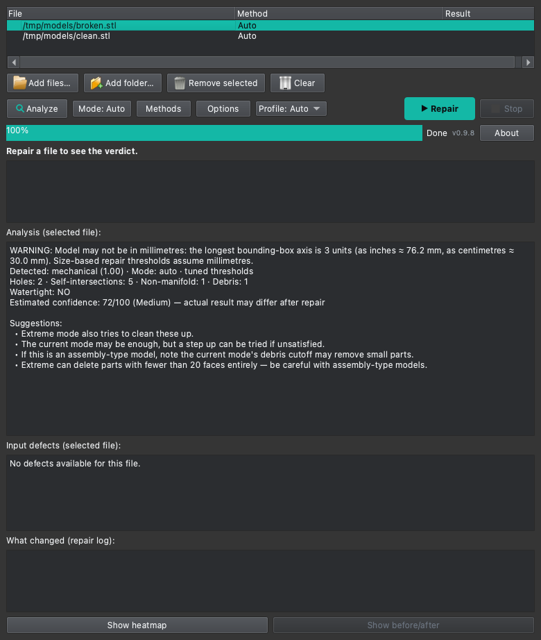
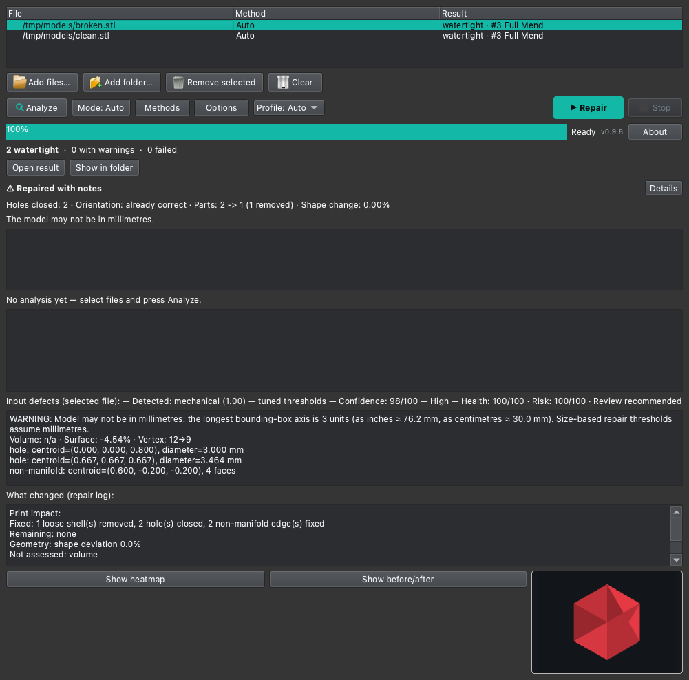
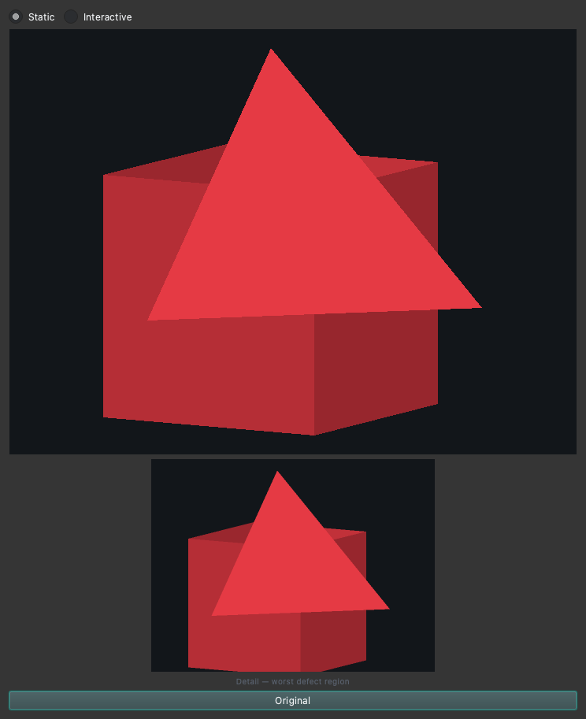

# Usage

[← Back to README](../../README.md) · [Türkçe](tr/usage.md)


Runs fully offline after installation — no telemetry, no network calls
during repair, works without internet once installed.

Sutura checks GitHub for updates only if you opt in (disabled by default).
Updates back up the previous install automatically and roll back if the new
version fails a self-check — no data beyond the update check itself is sent.
Auto-update stops at v0.2.0: starting with v0.2 the license changes to the
PolyForm Noncommercial 1.0.0 (commercial use requires a separate agreement),
so a v0.1.x install is never silently upgraded across that boundary — the new
terms are shown first and the release must be installed manually from the
releases page.

CLI:

```sh
sutura model.stl            # writes model_fixed.stl
sutura model.obj            # writes model_fixed.obj
sutura model.3mf -o fixed.3mf
sutura model.stl --human    # human-readable report
sutura model.stl --human --defects   # also list input holes / non-manifold regions
sutura model.stl --human --diff      # also print the before/after geometry diff
sutura model.stl --mode aggressive   # use the aggressive repair mode
sutura model.stl --classifier-engine classic  # force the classic classifier engine
sutura model.stl --max-geometry-change 10 --max-risk 40   # repair budgets (see below)
sutura model.stl --max-risk 30 --force                    # save even past the budget, no prompt
sutura validate model.stl   # analyze WITHOUT repairing (read-only report)
sutura model.stl --dry-run  # report what a repair would do, write NOTHING
sutura a.stl b.3mf c.stl    # batch: each file gets a _fixed output
sutura --version            # print the version and exit
```

OBJ note: materials/textures (`mtllib`/`usemtl`) are **not preserved** in the
repaired output — the mesh is rebuilt (vertices + triangles only), so texture
coordinates cannot be carried over. The report flags this as
`material_discarded` (JSON) and with a `Material:` line (`--human`) when the
input OBJ references them. 3D slicers ignore OBJ materials, so this only
matters if you keep the repaired OBJ for texturing.

**Validate (`validate`).** `sutura validate model.stl` analyzes a mesh and
reports it without repairing or writing anything — a read-only health check.
The JSON report carries `validation` (`holes` / `non_manifold` lists with
centroid + diameter / face counts, `self_intersections`, `connected_components`,
`watertight`, `signed_volume`, `surface_area`, `orientation`), plus
`detected_type` and `detected_confidence` from the mesh classifier.
`--human` prints it readably (`--defects` lists each defect region).
Multi-object 3MF files validate per object (`object_reports`). Exit 0 means
the analysis ran (even on a broken mesh); a missing / malformed input exits 1.

**Dry-run (`--dry-run`).** `sutura model.stl --dry-run` tells you what a
repair WOULD do without doing it: the detected type, the resolved repair
mode and exact Stage 1 thresholds (`mincomponentsize` / `maxholesize`),
`tuning_applied`, and what was found on the input (`holes_found` / largest
hole diameter / `non_manifold_regions` / `self_intersections` /
`debris_faces_removable`) plus whether stage 2 would run. It writes **no
output file at all** — no `_fixed`, no temp residue. The thresholds come from
the same `resolve_mode_params` the real repair uses, so the two can never
diverge.

**Repair mode (`--mode`).** A five-step aggressiveness ladder for Stage 1
thresholds, defaulting to **`auto`** (which is the historical behaviour: the
mesh classifier + confidence gate pick per-type thresholds). The fixed modes
bypass the classifier and use exact thresholds:

| Mode | `mincomponentsize` | `maxholesize` | Effect |
|---|---|---|---|
| `low` | 8 | 200 | most conservative: closes only small holes, minimal debris removal |
| `medium` | 8 | 1000 | the historical default thresholds |
| `auto` | — | — | classifier + confidence gate (default); type-dependent, so not fixed |
| `aggressive` | 12 | 3000 | more debris removed, larger holes closed |
| `extreme` | 20 | 10000 | most aggressive; note this can delete an object whose whole connected part has fewer than 20 faces — when that happens the report carries a distinct error (`category=error`, issue `extreme_removed_object`), not a generic malformed-input error. On top of the extreme thresholds it runs **extra self-intersection passes**: any self-intersecting faces are removed and the Stage 1 chain (hole closing + debris removal) runs a second time to catch what the removal exposed. Deliberately **not** a full remesh (`meshing_isotropic_explicit_remeshing` is out of scope — it can unpredictably change topology). |

The chosen mode is always reported (`repair_mode` in JSON, `Mode:` in
`--human`; per object for multi-object 3MF). For `extreme`, the report also
carries `extreme_passes_applied` (true when the extra passes ran) and, when
they did, `self_intersections_found`/`self_intersections_removed`; `--human`
shows an "Extreme passes" line. The GUI exposes the same five modes through
its **Mode** button (batch-wide, see the GUI section below).

**Repair profile (`--profile`).** An opt-in named preset for a repair
character, useful when you know the input's kind. Only effective while the
mode is `auto` — an explicit fixed mode always wins (it is the more specific
aggressiveness control). The classifier still runs (its type/confidence stay
in the report) but does not drive the thresholds:

| Profile | `mincomponentsize` | `maxholesize` | When to use |
|---|---|---|---|
| `mechanical` | 8 | 300 | precise/mechanical parts (modest hole fill) |
| `organic` | 12 | 1000 | smooth/organic models (drop debris, close larger regions) |
| `scan` | 4 | 10000 | scan meshes: aggressive debris removal + huge hole fill |
| `miniature` | 1 | 50 | tiny parts you want preserved (opt-in: the default path keeps `>= 8`) |
| `fast` | 8 | 200 | a quick pass that only closes small holes |

The chosen profile is reported (`repair_profile` in JSON, `Profile:` in
`--human`). Default (no `--profile`) is byte-identical to before. The GUI
exposes the same profiles through a **Profile** dropdown (batch-wide).
`sutura model.stl --profile scan` is equivalent to the old
`--mode aggressive`-style scan handling but keeps the mode at `auto`.

**Unit warning.** STL/OBJ files carry no unit metadata, and the size-based
repair thresholds (hole size, debris cutoff) assume millimetres. After
loading a mesh, Sutura computes its bounding box and, when the dimensions are
only plausible when scaled from inches or centimetres to millimetres, emits a
NON-BLOCKING warning (`unit_warning` + `unit_hint` in JSON, a `WARNING:` line
in `--human`, and a visible warning in the GUI) that the model may not be in
mm — verify the scale before printing. 3MF files declare their unit in the
`<model unit="...">` attribute: a declared inch/centimetre unit is reported
as-is, a declared millimetre unit (the spec default) is trusted and
suppresses the heuristic. The warning never changes the repair itself.

**Repair budget (`--max-geometry-change` / `--max-risk` / `--force`).** Two
optional guard-rails on how much a repair is allowed to alter a mesh, both
reusing metrics the repair already computes:
- `--max-geometry-change PCT` — the actual geometry change is
  `max(|volume change %|, |surface area change %|)`; a budget above this
  value is exceeded.
- `--max-risk SCORE` — the `repair_risk` score (0–100); a budget below the
  actual score is exceeded.
- `0` (or omitting the flag) disables a budget; the default is no budget at
  all, so existing behaviour is unchanged.

When a budget is exceeded the output is **never saved silently**: on an
interactive terminal you are prompted (`Save anyway? [y/N]`), and
non-interactive runs (the GUI subprocess, scripts, file-manager integration)
decline the save with exit 1. The report then carries the explicit top-level
`"status": "budget_declined"` marker (plus a `budget` block with the actual
numbers vs. the budgets, and the issue `budget_exceeded`) — a distinct,
machine-detectable outcome, separate from a generic repair error. `--force`
saves without prompting (the budget is still reported). When the repair is
within budget, saving proceeds normally and the `budget` block reports the
actual numbers so you can see they stayed inside the budget. For multi-object
3MF the WORST object drives the comparison. The GUI exposes the same two
budgets in its repair-options dialog and, after a batch, offers to re-run
budget-declined files with `--force` after an explicit confirmation.

**Automatic method fallback.** When the first repair is not watertight, Sutura
may try a few ranked methods. Before it does, it can skip a method the detected
damage makes pointless: duplicate faces skip Join, and interior faces or an
interior region skip Transplant and Wall Thicken. The baseline repair is never
changed by this; `SUTURA_TRIAGE_PRUNE=0` restores the previous fallback order.

Every repair report also carries a **repair confidence score**: a single
0–100 value (`repair_confidence` in JSON) with a High/Medium/Low label that
combines the stage 2 outcome, remaining holes, classifier confidence, tuning
status, repair mode, self-intersections and volume change; `--human` shows it
as a `Confidence: X/100 (Label)` line. The read-only modes report an estimate
instead, because the post-repair signals are not known yet: validate and
`--dry-run` carry `estimated_confidence` and print
`Estimated confidence: X/100 (Label) — actual result may differ after repair`.

Every repair report also carries **Repair Health / Repair Risk** — a separate
scoring system (independent of the classic confidence score, configurable via
`sutura/repair_score_config.json`):
- `repair_health` (0–100) — how geometrically sound the final mesh is: a
  weighted sum of watertight (stage 2 confirmed), no non-manifold edges, no
  self-intersections, no remaining holes.
- `repair_risk` (0–100) — how much the repair altered the mesh: face/vertex
  delta %, component changes, and volume delta %.
- `repair_status` / `repair_status_code` — a two-axis label derived from the
  Health/Risk tier combination via a config lookup table: `safe` ("Safe to
  inspect"), `review` ("Review recommended"), `caution` ("Caution advised"),
  `failed` ("Failed / inspect"), or `unavailable`. Health and Risk are
  independent axes, so a high-health + low-risk repair (`safe`) never
  collapses to the same status as a mid-health + high-risk one (`caution`).
  The per-factor contributions are also reported
  (`repair_health_factors` / `repair_risk_factors`).

`--human` shows them as `Health: X/100   Risk: Y/100   Status: <label>`.
Scoring is fail-silent: any missing/invalid metric is skipped (its weight
redistributed), and scoring never breaks a repair. Multi-object 3MF reports
carry these per object. The GUI defect panel shows them in the selected
file's header line.

### Print-impact report

Every repair report carries a `print_report` block that decomposes the outcome
into individual conditions and states how each one affects an FDM print. It is
a pure view over already-computed measurements — it never re-measures the mesh
— and it deliberately adds no rival "is it good" verdict: the single top-line
judgement stays the existing Repair Health / Risk / Status above. The block has
four parts:

- `fixed` — what the repair actually did, with counts: holes closed,
  non-manifold edges fixed, bad faces removed, loose shells removed, and
  whether the winding orientation was corrected.
- `issues` — the conditions that remain, each tagged with a severity:
  `breaks` (the mesh is not printable as-is, e.g. remaining holes or
  non-manifold edges), `may_affect` (e.g. several separate shells, a large
  volume change), or `cosmetic` (self-intersections, which slicers resolve at
  slice time with the even/odd rule and so do not change the printed part).
- `geometry` — volume change %, surface-area change % and the shape deviation
  (`deviation_max_pct` / `deviation_mean_pct`, the result surface toward the
  input, as a % of the bounding-box diagonal).
- `not_assessed` — measurements that were deliberately skipped, today the
  shape deviation on meshes above 150 000 faces (the gate keeps the repair fast
  on large scans).

The shape deviation is measured with the Rust `sutura_geom` point-to-mesh BVH
when the repair did not already produce one (Graft's per-vertex deviation or
Dressing's `hausdorff_rel_max` are reused when present). The severity
thresholds for the volume change (5 % may, 15 % breaks — the latter matching
the existing volume-warning threshold) and the deviation (1 % / 5 % of the
bounding-box diagonal) are engineering estimates, not calibration against a
print corpus, and each issue records `"heuristic": true` so the UI can label
them as such. Multi-object 3MF reports carry the block per object and an
aggregate that takes the worst object.

`--human` prints the block as a `Print impact:` section (`Fixed:` / `Remaining:` /
`Geometry:` / `Not assessed:`), and the GUI renders the same at the top of the
"What changed" repair log.

With multiple files, every input is repaired in turn and a summary is
printed (`N watertight, M with warnings, K failed`), including a breakdown of
the kinds of warnings/errors that occurred (volume change, Stage 2 skipped,
partial repair, malformed input, extreme-mode object deletion). The exit code is non-zero if any file
failed. In JSON mode each file's report also carries a `category`
(`watertight`/`warning`/`error`) and an `issues` list, and the batch summary
gains `summary.issue_counts`. `-o` is only valid with a single file. In JSON
mode each file's report also includes a `defects` list describing the input's
holes (centroid, diameter) and non-manifold regions; in `--human` mode this
list is shown only when `--defects` is passed, so the default report stays
concise. Diameter values assume millimetres, the common STL/3MF convention;
if your file uses a different unit, scale the interpretation accordingly
(Sutura also flags likely non-millimetre models with a unit warning — see the
Unit warning section above).

Every report also records the before/after geometry in `stage1`:
`volume_change_percent` (signed), `surface_area_before`/`after` and
`surface_area_change_percent`, and `vertices_before`/`after`,
`faces_before`/`after`. These are always in the JSON and shown per object for
multi-object 3MF files; `--human --diff` prints them too, and the GUI defect
panel shows a one-line summary ("Volume: +0.12% · Surface: -2.37% · Vertex:
12→9").

A mesh is only counted as **watertight** when stage 2 ran and
validated the closed solid. If stage 1 closes a mesh but stage 2 is skipped,
errors, or never runs (for example the macOS/conda in-process fallback being
unavailable), the file is reported as a warning, not watertight.

A saved STL can still reload with **pinched (non-manifold) vertices** even when
stage 2 is two-manifold in memory: STL stores no vertex sharing, so two vertices
that are distinct in memory but identical after the float32 write are welded
into one. The P-WELD pass checks this reload form, separates the
float32-coincident vertices when that is the cause (face count unchanged,
sub-ULP geometry nudge), and records `p_weld`
(`non_two_manifold_before`/`after`, `vertices_nudged`, `method`). If the issue
cannot be resolved, the report carries `reload_watertight=false` and
`stage1.reload_non_manifold_vertices`, and the file is a warning, never
watertight.

Multi-object 3MF files are handled natively: every object mesh is repaired
independently and written back into the archive, so no object is lost. An
object that stage 1 closes (two-manifold, no holes remaining) is then passed
through the same stage 2 helper as single-mesh files, so it gets a Manifold
watertight rebuild and a per-object `stage2` report. When auto escalation runs,
it operates per object: objects that reload strict-watertight after the baseline
repair are left untouched, while failing objects escalate through ranked
recommendations independently; each object in `object_reports` receives its own
`method_used` report. The report lists the result per object (holes remaining,
two-manifold, stage-2 verdict) and carries the aggregates `objects_watertight` /
`objects_stage2_ok`; the file's category is derived from **all** objects, so a
single still-open object prevents the whole file being reported watertight. Defects
are also computed per object (`object_reports[i].defects`); there is no
top-level aggregate `defects` field for a 3MF. Objects with byte-identical
geometry reuse one repair, but each still gets its own per-object report (the
stage-2 outcome is a pure function of the geometry, so the cached object's
report is valid for the duplicates too).

3MF repair is non-destructive for single-object and multi-object projects
alike: Sutura opens the source archive and rewrites only the repaired objects'
`<mesh>` XML. Every other entry (thumbnails, slicer configs, plate and
wipe-tower data, content types, relationships and Production-extension
sub-model files under `3D/Objects/`) keeps its name, order, decompressed bytes,
compression type and ZIP metadata. Object/build IDs, component transforms,
units and namespace declarations are preserved. Phase 1 also keeps per-triangle
slicer attributes (`paint_color`, `paint_seam`, `paint_supports`,
`paint_fuzzy_skin`, `slic3rpe:mmu_segmentation`, `pid`/`p1`, ...) on triangles
that survive with unchanged vertex coordinates; newly created triangles are not
given inherited paint. The JSON report carries `triangle_attributes` per object
(`original_attributed`, `kept`, `dropped`, `output_triangles`) and a summed
file-level value for multi-object 3MF. Regression-tested in
`tests/test_3mf_roundtrip.py`.

GUI:

```sh
~/.local/share/sutura/gui.py
```

The GUI supports batch repair: add any number of files, press **Repair**,
and each one is processed in turn with its result listed per file. When the
batch finishes, a summary strip appears above the log (`X watertight, Y with
warnings, Z failed`) with a clickable **show issues** link that lists the
warning/error types and how many files each affected. Selecting a file shows
its input defects (holes with their diameter and non-manifold regions) in a
panel below the log, separate from the batch summary strip. Files can be added
with **Add files…** (native multi-select, rubber-band included), **Add
folder…** (every `.stl`/`.3mf` in the folder, one level deep), or by dragging
files or folders onto the window. **Stop** terminates the running repair and
marks the remaining files as cancelled. Drag & drop works on native Wayland
sessions (the GUI is a Qt application, not XWayland). The GUI ships its own
dark Fusion theme (teal accent), so it looks the same on every platform and
Qt version regardless of the system desktop theme. The batch-wide repair
options — the fTetWild fallback tier and the opt-in experimental passes — sit
in a separate **Options** window (button next to **Mode**, or Ctrl+, /
Cmd+,) that can stay open while repairing; the button label shows how many
options differ from their defaults, e.g. *Options (2)*. Its tabs: *General*
(anonymous usage history), *Repair* (fTetWild fallback plus the Triage
intensity preset/profile selector and the profile editor), *Experimental*
(opt-in passes), *Updates* (manual check, automatic updates, optional check
on every start), *Changelog* (release notes from GitHub, with an offline
fallback) and *Engines* (fTetWild install/remove and the configured
external-engine list).

#### Pre-repair analysis



Before repairing, **Analyze** runs the same read-only checks as the CLI's
`validate` and `--dry-run` on every file, without writing anything: it
reports the detected type and repair mode, the tuning status, the input's
holes / self-intersections / non-manifold / debris counts, a watertight
pre-verdict, and an **estimated confidence**
(`Estimated confidence: X/100 (Label) — actual result may differ after
repair`, because the post-repair signals are not known yet). Below that it
lists a few **mode suggestions** (e.g. an aggressive/extreme step for
scan-derived holes, a gentle "the current mode may be enough, but a step
up can be tried if unsatisfied" tip whenever the input has at least one
hole, a low-confidence step-up tip only while the current mode is still
gentle, or a caveat when extreme could delete small parts).
The suggestions are **informational only and never change the mode
automatically — the decision stays with the user.** A non-blocking unit
warning (model may be authored in inches/cm) is also shown when the heuristic
fires.

#### Defect detail panel



When a file is selected, the panel below the log lists the defects found in
its input mesh: each hole's centroid and diameter (in mm) and each
non-manifold region. This complements the batch summary strip above the log —
the strip is a per-batch count, this panel is per-file detail. After a repair,
the panel header also shows the result's confidence as a
`Confidence: X/100 — High/Medium/Low` segment. If the model may not be in
millimetres, a non-blocking unit warning appears in the log and at the top of
this panel (see the Unit warning section above).

**Defect heatmap.** Below the defect list, **Show heatmap** renders the
selected mesh with its defect regions (hole rims and non-manifold areas)
highlighted red against the grey mesh, shown as a small thumbnail. Clicking
the thumbnail opens a larger zoom dialog. Rendering is on-demand (never
automatic, so a large batch doesn't stall) and cached per file. For a
multi-object 3MF it renders the first object, matching the defect panel's
existing first-object behaviour. The renderer is a CPU rasterizer (works
headless, in the AppImage, and on macOS CI) that runs in a subprocess so the
GUI stays responsive and crash-free; if a mesh can't be rendered it falls
back silently to the text-only panel.

**Before/after comparison.** After a file is repaired, **Show before/after**
renders the original and repaired meshes with the *same* camera framing and
opens a dialog with the main image, a toggle button that flips between
**Original** and **Repaired**, and — below the main image — a smaller
**detail** close-up of the *worst original defect region* (the defect with
the largest physical bounding-box diagonal). The camera is automatically
directed toward that worst defect so it is never hidden behind the mesh;
only a clean mesh (or a defect sitting at the mesh's bounding-box centre)
falls back to the fixed isometric view. The repaired view uses a
tri-state colour map: **grey** where the mesh was never broken, a vivid
**green** `(46,204,113)` highlight where an original defect used to be and
is now healthy, and **orange** `(255,140,60)` where a defect remains (the
original view marks its defects in red `(235,60,70)`). Because repair changes the mesh
topology (the before/after vertex indices don't correspond), the green
classification is *spatial*: each repaired face is measured against the
original defect centroids (their real extent from `defects.detect`), and
only the largest defects (capped at 256) drive the highlight so a scan mesh
with thousands of micro-cracks stays fast. The close-up uses the same zoomed
camera for both sides, so the original vs repaired comparison is
apples-to-apples. It is a static click-toggle, deliberately not an
interactive 3D slider — same CPU-renderer constraint as the heatmap — and


runs in a subprocess on-demand, so it never slows a batch.

A **Static / Interactive** switch at the top of the dialog adds the
interactive 3D view (built lazily the first time it is chosen, then cached
for the dialog's lifetime): **drag** rotates the mesh, the **mouse wheel**
zooms. While you drag, an interactive low-poly LOD is rasterized per frame
on a background thread (latest frame wins, no mesh loading in the GUI
process); ~300 ms after you stop, a full-resolution frame is drawn. The
interactive view starts at the same defect-facing camera as the static
comparison. A second toggle switches the repaired view between the
**Repair status** colour map and a **Surface deviation** map: each face is
coloured by the distance of the repaired surface to the original surface
(quantile-scaled ramp, navy → cyan → yellow → red) with the still-broken
defects drawn on top in orange and the global max deviation (Hausdorff
distance) shown in the dialog.

**Repair mode.** A **Mode: Auto** button next to the heatmap/before-after
buttons opens a small dialog with a five-step slider —
**Low / Medium / Auto / Aggressive / Extreme** — and a one-line description
that updates live as the slider moves (the Extreme step warns it can delete
objects smaller than 20 faces). The same dialog also carries the two
**repair budgets** (max geometry change %, max repair risk 0–100; 0 = no
limit). The mode is a **batch-wide** setting: it
applies to the next Repair run for every file, not per file, and is passed to
the CLI as `--mode <mode>` (the same five values as the CLI flag, default
`auto`). The current mode is always shown on the button.

When a repair exceeds a budget, the CLI declines the save (no output file)
and reports `"status": "budget_declined"`; after the batch the GUI shows a
confirmation dialog listing the affected files and their actual numbers, and
**Save anyway?** re-runs exactly those files with `--force` (the declined
rows are then overwritten by the forced results).

Dolphin: right-click an STL/OBJ/3MF file -> **Repair with Sutura**. With a single
selection the GUI opens with the file loaded; with multiple selections each
file is repaired headlessly and a summary dialog is shown.

After installing or removing the service menu, run `kbuildsycoca6` (the
installer does this automatically) or restart Dolphin.

### OrcaSlicer plugin (experimental)

There is also an **experimental** [OrcaSlicer script plugin](../../orcaslicer-plugin/)
under `orcaslicer-plugin/` for the **new OrcaSlicer script-plugin API**. It
targets OrcaSlicer **2.5.0+ / nightly builds** — the 2.4.x releases have no
"Plugins" menu, so the plugin will not work there.

Running the plugin opens a dockable **"Sutura" panel** beside the 3D view (and
automatically at startup unless disabled). The panel lists **every object on
the plate** and offers a Quick / Balanced / Thorough / Extreme preset picker
(Balanced default), per-object **Analyze** (read-only: holes, non-manifold
regions, self-intersections and the top ranked repair methods) and **Repair**,
a "Repair selected (n)" footer button and a "Select broken" shortcut, live job
phases (queued → exporting → repairing → loading → done / failed / cancelled)
with a Cancel button, and a **Show file** link for a finished job. Repair and
Analyze always run through the installed Sutura CLI as a subprocess.

Objects that OrcaSlicer repaired on import (mesh errors) or whose parts are
non-manifold raise **one warning notification per object per session** with a
"Repair with Sutura" action. The export writes each model-part volume of an
object in **world coordinates** (mirrored parts keep outward-facing winding),
skips parameter modifiers, negative volumes and support blockers, and merges a
multi-part object into a single STL. The repaired copy is loaded back as a
**new object**; because the export is in world coordinates OrcaSlicer may place
it on top of the original — press **A** (Arrange) to separate it, or
**Ctrl/Cmd+Z** to remove it. Output files are kept for seven days so OrcaSlicer
can read them while the asynchronous load-back completes. `numpy` is a declared
plugin dependency (installed by OrcaSlicer's bundled uv), with a numpy-free
fallback path.

Install (OrcaSlicer 2.5.0+ / nightly):

1. Install Sutura first (`./install.sh` on Linux, `install-macos.sh` on macOS)
   so `~/.local/bin/sutura` exists.
2. Copy the plugin into OrcaSlicer's plugin directory. Linux:

   ```sh
   mkdir -p ~/.config/OrcaSlicer/orca_plugins/SuturaRepair
   cp sutura_repair_linux_x86_64.py ~/.config/OrcaSlicer/orca_plugins/SuturaRepair/
   ```

   macOS: use `~/Library/Application Support/OrcaSlicer/orca_plugins/` as the
   parent. The file name is a naming artifact — the same single file runs on
   both Linux and macOS.
3. Enable the plugin in the OrcaSlicer **Plugins** dialog, then run it to open
   the panel.

Permissions: `register_capabilities()` pre-declares the existing Sutura CLI
path with `request_permissions(fs_read=...)`, but the audit API has no
declarative form for subprocess spawns, so a spawn permission prompt can still
appear once per command target. It has been verified end-to-end in a real
OrcaSlicer **2.5.0-dev** nightly (macOS); the first stable release with the
plugin API is 2.5.0; primary target is Linux, and the same file
runs on macOS as a verified bonus. See the
[plugin README](../../orcaslicer-plugin/README.md) for full detail and its
limitations.
