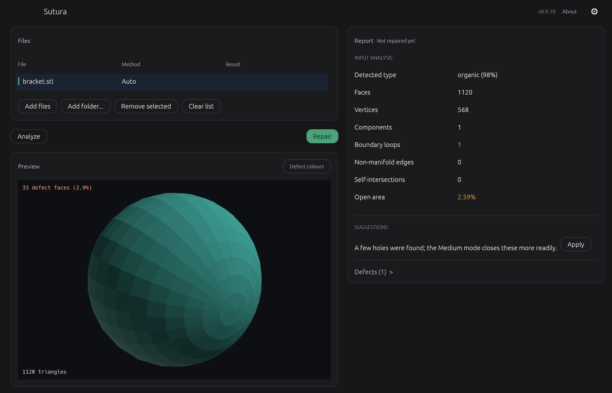
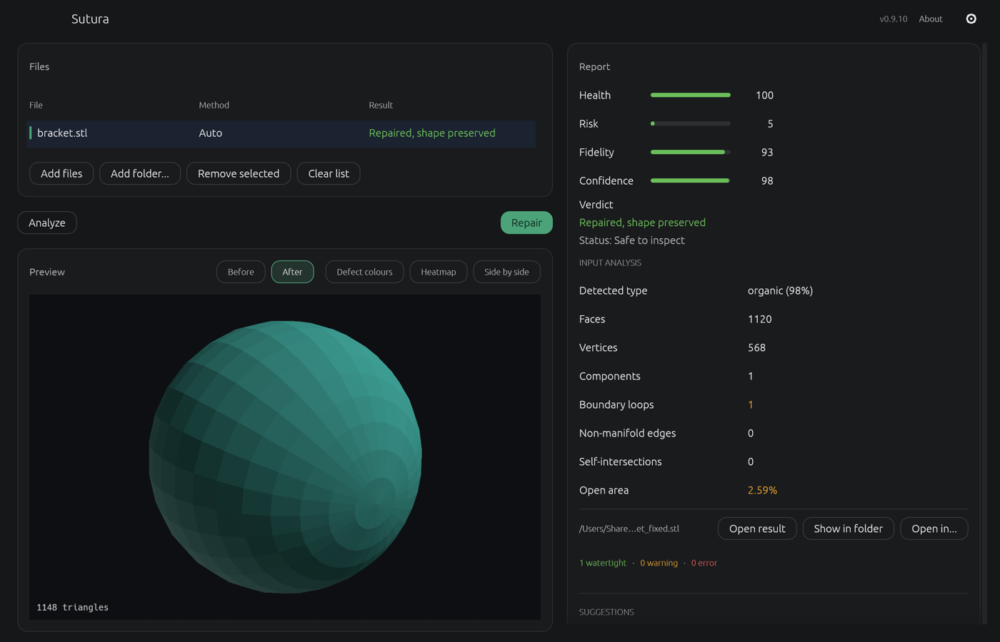
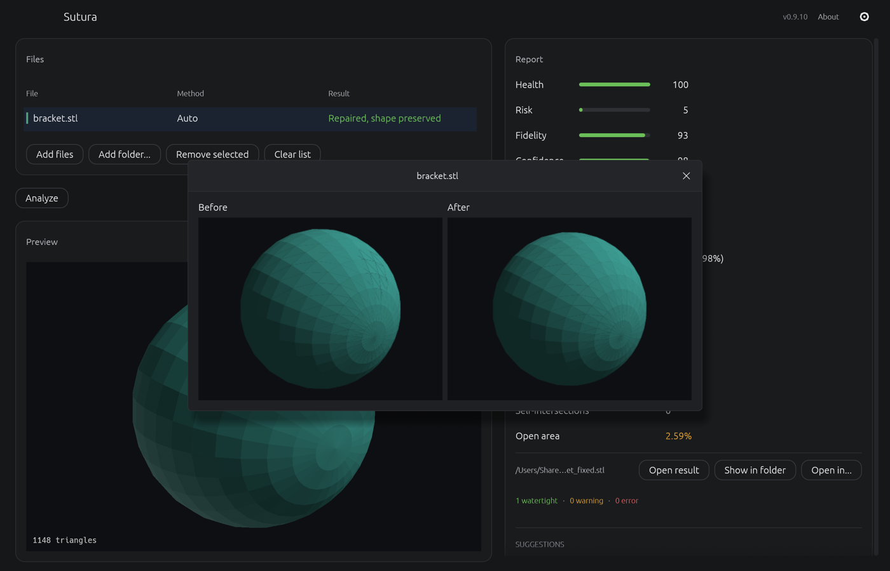

# Usage

[← Back to README](../../README.md) · [Türkçe](tr/usage.md)


Runs fully offline after installation — no telemetry, no network calls
during repair, works without internet once installed.

Sutura checks GitHub for updates only when you ask it to. Updates back up the
previous install automatically and roll back if the new version fails a
self-check — no data beyond the update check itself is sent. Auto-update stops
at v0.2.0: starting with v0.2 the license changes to the PolyForm Noncommercial
1.0.0 (commercial use requires a separate agreement), so a v0.1.x install is
never silently upgraded across that boundary — the new terms are shown first and
the release must be installed manually from the releases page.

CLI:

```sh
sutura model.stl            # writes model_fixed.stl
sutura model.obj            # writes model_fixed.obj
sutura model.3mf -o fixed.3mf
sutura model.stl --human    # human-readable report
sutura model.stl --human --defects   # also list input holes / non-manifold regions
sutura model.stl --human --diff      # also print the before/after geometry diff
sutura model.stl --mode aggressive   # use the aggressive repair mode
sutura model.stl --classifier-engine classic  # force the classic classifier engine
sutura model.stl --max-geometry-change 10 --max-risk 40   # repair budgets (see below)
sutura model.stl --max-risk 30 --force                    # save even past the budget, no prompt
sutura model.stl --no-fidelity                            # skip the shape score (report only)
sutura validate model.stl   # analyze WITHOUT repairing (read-only report)
sutura model.stl --dry-run  # report what a repair would do, write NOTHING
sutura a.stl b.3mf c.stl    # batch: each file gets a _fixed output
sutura --version            # print the version and exit
sutura model.stl --human --debug  # show a traceback for an unexpected error
```

The first repair writes `model_fixed.stl` (or `.obj`/`.3mf`). If that name
already exists, the CLI writes `model_fixed_2.stl`, then `_3`, and never
overwrites the earlier file. An explicit `-o PATH` still writes exactly PATH
and keeps its explicit-overwrite meaning.

**Progress and cancel.** With `--human`, a single progress line is shown on
stderr only when stderr is a terminal (stage, step 3/8, elapsed time);
`--no-progress` disables it. The line is never written to pipes or captured
stderr. With `--json`, add `--progress-json` to emit optional NDJSON progress
events on stderr; stdout remains one JSON document and the default JSON output
is unchanged. Each event is
`{"event":"start|stage|end|cancel","file":…,"file_index":…,"file_total":…,
"step_total":8,"elapsed_s":…}`; a `stage` event also carries `"stage"`,
`"step"` (1–8) and optional `"detail"`.
Ctrl-C cancels at stage boundaries and at the native work-counter
checkpoints, exits 130, and leaves no partial output (`*_fixed` is written only
after the repair completes).

**Exit status.** `0` success; `1` runtime failure (per-file repair/validate/
analyze error, malformed input, a declined budget save, or a missing
`sutura_geom`); `2` usage error (invalid flag, combination or range); `130`
interrupted (Ctrl-C). Unexpected errors print a short `error:` message and a
`--debug` hint — add `--debug` (or `SUTURA_DEBUG=1`) to see the traceback.
With `--human`, errors go to stderr; the default JSON mode keeps
`{"error": ...}` on stdout. `--self-check` keeps its 0/1 contract (0 when every
method loads, 1 when any fails). `--update`, `--rollback` and `--repair-install`
exit 0 when you decline at the prompt, since nothing went wrong.

**Install and update commands.** These do not repair anything; they manage the
installed program. `--update`, `--rollback` and `--repair-install` all ask
before replacing files, and the answer **defaults to no** — a bare Enter
declines. `--yes` answers for you, and a run with no terminal (a script, CI)
also declines and says so.

| Command | What it does |
|---|---|
| `sutura --version` | print the version (`sutura <version>`) and exit |
| `sutura --check-update` | report whether a newer release exists. **Never installs.** Prints `update available: <tag>`, `no update available`, or a licence notice when the release crosses a licence boundary, in which case it refuses and points at the releases page |
| `sutura --update` | download, verify, install the newest release, health-check it, and roll back if it does not start |
| `sutura --rollback` | restore the **newest** backup over the installed files. Two are kept; there is no command to choose an older one |
| `sutura --repair-install` | reinstall the version you are **running** over itself; never upgrades or downgrades |
| `sutura --whats-new` | print the release notes saved by the last successful install, offline |
| `sutura --migrate-from-python --from-artifact PATH --yes` | move an existing Python install to this build; see [MIGRATE.md](../../MIGRATE.md) |

`--repair-install` also answers to `--self-repair` and `--repair-installation`.
`--check-update` writes the check time to `~/.config/sutura/config.json`; it is
the only one of these that touches your config.

`--whats-new` reads a snapshot written when an install succeeds. On a fresh
install there may not be one yet, and the command says so and points at the
releases page.

**Thin-wall thickening (`--wall-min-thickness`).** Wall Thicken (method #15) is
opt-in and never runs automatically. The value in millimetres is both the target
and the switch: passing it turns the tier on, and it measures every vertex's wall
thickness from an SDF grid and thickens anything below the target.

```sh
sutura model.stl --wall-min-thickness 1.5
```

Without the flag the tier does not run at all. With it, the report gains a
`wall_thicken` block (`min_before`, `thin_before`, `faces`, `delta`, and whether
the result was adopted). The tier can create geometry, so it is gated like every
other: the candidate is adopted only if it does not make the topology worse,
which on many meshes means it reports what it measured and leaves the mesh
alone.

OBJ note: materials/textures (`mtllib`/`usemtl`) are **not preserved** in the
repaired output — the mesh is rebuilt (vertices + triangles only), so texture
coordinates cannot be carried over. The report flags this as
`material_discarded` (JSON) and with a `Material:` line (`--human`) when the
input OBJ references them. 3D slicers ignore OBJ materials, so this only
matters if you keep the repaired OBJ for texturing.

**Validate (`validate`).** `sutura validate model.stl` analyzes a mesh and
reports it without repairing or writing anything — a read-only health check.
The JSON report carries `validation` (`holes` / `non_manifold` lists with
centroid + diameter / face counts, `self_intersections`, `connected_components`,
`watertight`, `signed_volume`, `surface_area`, `orientation`), plus
`detected_type` and `detected_confidence` from the mesh classifier.
`--human` prints it readably (`--defects` lists each defect region).
Multi-object 3MF files validate per object (`object_reports`). Exit 0 means
the analysis ran (even on a broken mesh); a missing / malformed input exits 1.

**Dry-run (`--dry-run`).** `sutura model.stl --dry-run` tells you what a
repair WOULD do without doing it: the detected type, the resolved repair
mode and exact Stage 1 thresholds (`mincomponentsize` / `maxholesize`),
`tuning_applied`, and what was found on the input (`holes_found` / largest
hole diameter / `non_manifold_regions` / `self_intersections` /
`debris_faces_removable`) plus whether stage 2 would run. It writes **no
output file at all** — no `_fixed`, no temp residue. The thresholds come from
the same `resolve_mode_params` the real repair uses, so the two can never
diverge.

**Repair mode (`--mode`).** A five-step aggressiveness ladder for Stage 1
thresholds, defaulting to **`auto`** (which is the historical behaviour: the
mesh classifier + confidence gate pick per-type thresholds). The fixed modes
bypass the classifier and use exact thresholds:

| Mode | `mincomponentsize` | `maxholesize` | Effect |
|---|---|---|---|
| `low` | 8 | 200 | most conservative: closes only small holes, minimal debris removal |
| `medium` | 8 | 1000 | the historical default thresholds |
| `auto` | — | — | classifier + confidence gate (default); type-dependent, so not fixed |
| `aggressive` | 12 | 3000 | more debris removed, larger holes closed |
| `extreme` | 20 | 10000 | most aggressive; note this can delete an object whose whole connected part has fewer than 20 faces — when that happens the report carries a distinct error (`category=error`, issue `extreme_removed_object`), not a generic malformed-input error. On top of the extreme thresholds it runs **extra self-intersection passes**: any self-intersecting faces are removed and the Stage 1 chain (hole closing + debris removal) runs a second time to catch what the removal exposed. Deliberately **not** a full remesh (`meshing_isotropic_explicit_remeshing` is out of scope — it can unpredictably change topology). |

The chosen mode is always reported (`repair_mode` in JSON, `Mode:` in
`--human`; per object for multi-object 3MF). For `extreme`, the report also
carries `extreme_passes_applied` (true when the extra passes ran) and, when
they did, `self_intersections_found`/`self_intersections_removed`; `--human`
shows an "Extreme passes" line. The GUI exposes the same five modes through
its **Mode** button (batch-wide, see the GUI section below).

**Repair profile (`--profile`).** An opt-in named preset for a repair
character, useful when you know the input's kind. Only effective while the
mode is `auto` — an explicit fixed mode always wins (it is the more specific
aggressiveness control). The classifier still runs (its type/confidence stay
in the report) but does not drive the thresholds:

| Profile | `mincomponentsize` | `maxholesize` | When to use |
|---|---|---|---|
| `mechanical` | 8 | 300 | precise/mechanical parts (modest hole fill) |
| `organic` | 12 | 1000 | smooth/organic models (drop debris, close larger regions) |
| `scan` | 4 | 10000 | scan meshes: aggressive debris removal + huge hole fill |
| `miniature` | 1 | 50 | tiny parts you want preserved (opt-in: the default path keeps `>= 8`) |
| `fast` | 8 | 200 | a quick pass that only closes small holes |

The chosen profile is reported (`repair_profile` in JSON, `Profile:` in
`--human`). Default (no `--profile`) is byte-identical to before. The GUI
exposes the same profiles through a **Profile** dropdown (batch-wide).
`sutura model.stl --profile scan` is equivalent to the old
`--mode aggressive`-style scan handling but keeps the mode at `auto`.

**Unit warning.** STL/OBJ files carry no unit metadata, and the size-based
repair thresholds (hole size, debris cutoff) assume millimetres. After
loading a mesh, Sutura computes its bounding box and, when the dimensions are
only plausible when scaled from inches or centimetres to millimetres, emits a
NON-BLOCKING warning (`unit_warning` + `unit_hint` in JSON, a `WARNING:` line
in `--human`, and a visible warning in the GUI) that the model may not be in
mm — verify the scale before printing. 3MF files declare their unit in the
`<model unit="...">` attribute: a declared inch/centimetre unit is reported
as-is, a declared millimetre unit (the spec default) is trusted and
suppresses the heuristic. The warning never changes the repair itself.

**Repair budget (`--max-geometry-change` / `--max-risk` / `--force`).** Two
optional guard-rails on how much a repair is allowed to alter a mesh, both
reusing metrics the repair already computes:
- `--max-geometry-change PCT` — the actual geometry change is
  `max(|volume change %|, |surface area change %|)`; a budget above this
  value is exceeded.
- `--max-risk SCORE` — the `repair_risk` score (0–100); a budget below the
  actual score is exceeded.
- `0` (or omitting the flag) disables a budget; the default is no budget at
  all, so existing behaviour is unchanged.

When a budget is exceeded the output is **never saved silently**: on an
interactive terminal you are prompted (`Save anyway? [y/N]`), and
non-interactive runs (scripts, file-manager integration)
decline the save with exit 1. The report then carries the explicit top-level
`"status": "budget_declined"` marker (plus a `budget` block with the actual
numbers vs. the budgets, and the issue `budget_exceeded`) — a distinct,
machine-detectable outcome, separate from a generic repair error. `--force`
saves without prompting (the budget is still reported). When the repair is
within budget, saving proceeds normally and the `budget` block reports the
actual numbers so you can see they stayed inside the budget. For multi-object
3MF the WORST object drives the comparison. The GUI exposes the same two
budgets in its repair-options dialog and, after a batch, offers to re-run
budget-declined files with `--force` after an explicit confirmation.

**Automatic method fallback.** When the first repair is not watertight, Sutura
may try a few ranked methods. Before it does, it can skip a method the detected
damage makes pointless: duplicate faces skip Join, and interior faces or an
interior region skip Transplant and Wall Thicken. The baseline repair is never
changed by this; `SUTURA_TRIAGE_PRUNE=0` restores the previous fallback order.

Every repair report also carries a **repair confidence score**: a single
0–100 value (`repair_confidence` in JSON) with a High/Medium/Low label that
combines the stage 2 outcome, remaining holes, classifier confidence, tuning
status, repair mode, self-intersections and volume change; `--human` shows it
as a `Confidence: X/100 (Label)` line. The read-only modes report an estimate
instead, because the post-repair signals are not known yet: validate and
`--dry-run` carry `estimated_confidence` and print
`Estimated confidence: X/100 (Label) — actual result may differ after repair`.

Every repair report also carries **Repair Health / Repair Risk / Fidelity** —
a separate scoring system (independent of the classic confidence score,
configurable via `sutura/repair_score_config.json`):
- `repair_health` (0–100) — how geometrically sound the final mesh is: a
  weighted sum of watertight (stage 2 confirmed), no non-manifold edges, no
  self-intersections, no remaining holes.
- `repair_risk` (0–100) — how much the repair altered the mesh: face/vertex
  delta %, component changes, and volume delta %.
- `repair_fidelity` (0–100) — how much the repair kept the *shape*: the
  one-sided distance of the result to the input on the healthy (non-defect)
  surface, feature-edge recall, healthy fill/removal volume, volume and
  bounding-box change, and the area of newly created surface. It is measured
  once on the final result, after every candidate decision, and never changes
  which candidate is adopted. Missing factors are skipped (their weight is
  redistributed), so the score stays meaningful on smooth models where the
  sharp-edge term does not apply. Interior walls of the input's own overlapping
  parts are excluded from that recall (they are not visible surface) and
  reported separately as `interior_walls_removed_faces` /
  `interior_walls_removed_area_mm2`.
- `repair_status` / `repair_status_code` — a two-axis label derived from the
  Health/Risk tier combination via a config lookup table: `safe` ("Safe to
  inspect"), `review` ("Review recommended"), `caution` ("Caution advised"),
  `failed` ("Failed / inspect"), or `unavailable`. Health and Risk are
  independent axes, so a high-health + low-risk repair (`safe`) never
  collapses to the same status as a mid-health + high-risk one (`caution`).
  The per-factor contributions are also reported
  (`repair_health_factors` / `repair_risk_factors` /
  `repair_fidelity_factors`).
- `repair_verdict_code` / `repair_verdict_areas` — the Fidelity **shape**
  verdict in the JSON report and its changed-area count: `preserved`
  ("Repaired, shape preserved"), `changed` ("Repaired, shape changed in N
  area(s) - check"), `low_confidence` ("... in N guessed area(s) ..."),
  `not_repaired` ("Not fully repaired") or `unavailable`. The JSON field never
  contains the display-only `ready` / `notes` codes. The CLI `--human` and the
  GUI fold it with the topology verdict into ONE headline: a failed repair (or
  Health below the mid tier) reads `not_repaired` even if the untouched parts
  still match; with topology caveats but a preserved shape the headline is
  "Repaired with notes — shape preserved", never a clean "shape preserved"; and
  when Fidelity is not measured it falls back to the plain brief verdict
  ("Ready to print" / "Repaired with notes").
  Large invented areas (a big hole cap, fTetWild/Splint rebuild) set
  `repair_verdict_low_confidence`: the reconstruction there is a guess, not a
  measurement. The per-area counts and low-confidence cluster detail are
  measured on meshes below the analysis budget; larger meshes keep the score
  and the verdict but report the area count as unavailable; the sharp-edge
  term is also skipped on very large meshes for the same reason, and
  `repair_fidelity_note` says so. If the input has no measurable healthy skin
  (or every closest-point result is invalid) the score is `unavailable`, never
  a fabricated 100. On multi-object files a low-confidence object wins the
  file headline. The 0.1 mm detail tolerance is capped by
  `0.2 %` of the bounding-box diagonal, so miniatures and metre-scale exports
  scale correctly.
- `interior_walls_removed_faces` / `interior_walls_removed_area_mm2` — input
  faces that were interior walls of the input's own solid union (overlapping
  parts) and are not within tolerance of the output;
  `interior_walls_buried_faces` / `interior_walls_buried_area_mm2` is the
  input-alone count before removal, and `interior_walls_debris_faces` /
  `interior_walls_cavity_faces` are diagnostics. These faces are excluded from
  the `feature_recall` denominator, so they never read as lost visible
  surface; the all-input value stays in
  `repair_fidelity_metrics.feature_recall_all`.

`--human` prints that one verdict on its own line, then
`Health: X/100   Risk: Y/100   Fidelity: Z/100` as the numbers (the numbers no
longer repeat the verdict); `repair_status` stays on the following details
line. When interior walls were removed, it also prints `Interior walls
removed: N faces (A mm²)`.
`--no-fidelity` (or the Options checkbox) skips the measurement; it is
reporting-only, so it never changes the saved mesh. Scoring is fail-silent: any
missing/invalid metric is skipped (its weight redistributed), and scoring never
breaks a repair. Multi-object 3MF reports carry these per object; the file-level
Fidelity is the worst object and the changed/low-confidence area counts are
summed. The GUI shows the same single headline in the report summary, with the
full report — now localized in English and Turkish — folded behind the
**Details** toggle.

### Understanding the repair report

#### Score cheat sheet

Every repair report presents three independent 0–100 shape and mesh indicators alongside the triage confidence score:

| Score | Scale | Good direction | What it measures |
|---|---|---|---|
| **Health** | 0 – 100 | **HIGHER is better** (100 is ideal) | **Topological & structural integrity.** 100 indicates a fully closed, watertight 2-manifold solid with zero holes, zero non-manifold edges, zero bad faces, zero residual self-intersections, and correct face winding orientation. Lower scores indicate remaining defects. |
| **Risk** | 0 – 100 | **LOWER is better** (0 is ideal) | **Degree of mesh alteration.** Measures how much the repair altered the original geometry (face/vertex count deltas, volume shifts, shell pruning, or solid remeshing). A low risk score (0–25) means the part was gently patched; high risk (> 60) signals aggressive reconstruction. |
| **Fidelity** | 0 – 100 | **HIGHER is better** (100 is ideal) | **Shape preservation on healthy regions.** Measures one-sided Hausdorff deviation, sharp feature-edge recall (dihedral angles), and healthy fill/removal. **Report-only:** does not block candidate adoption. If large damaged sections were reconstructed from scratch, the headline warns `guessed area(s) - check`. Interior walls of overlapping input parts are excluded from feature-edge recall and reported separately. |
| **Confidence** | 0 – 100 / High-Med-Low | *Diagnostic certainty* | **Triage classifier confidence.** Indicates how confident Sutura was when diagnosing the input mesh defect category and selecting the initial repair strategy. It reflects input analysis certainty, independent of the geometric quality of the output. |

> [!TIP]
> **Remember the Risk inversion:** While Health and Fidelity follow the common "higher is better" rule, **Risk is a penalty metric where 0 is untouched and 100 is severe alteration**. A repair with `Health: 100   Risk: 1   Fidelity: 100` is nearly perfect!

#### Headline verdicts & inspection advice

The CLI `--human` mode and the GUI collapse the topology brief and Fidelity shape check into **one headline**:
- `Ready to print` / `Repaired, shape preserved`: Topology is closed and sound; original surface details are intact.
- `Repaired with notes — shape preserved`: Topology was closed, but with informational notes (e.g., thin walls or residual cosmetic self-intersections); surface shape was preserved.
- `Repaired, shape changed in N area(s) - check`: Topology is sound, but aggressive fallback repair was required and shifted the healthy surface by more than 1.0% of the bounding-box diagonal (and Fidelity is below the 85 high tier).
- `Repaired, shape changed in N guessed area(s) - check`: Missing or destroyed sections were rebuilt by solid reconstruction (such as fTetWild, Splint, or a large Tamponade cap); the geometry in those areas is an algorithmic estimate. If a model exhibits both healthy-surface drift and large reconstructed areas, `low_confidence` wins the headline over `changed`.
- `Not fully repaired` / `Failed`: Defect counts could not be fully resolved to a watertight manifold state within safe limits.

When a report headline advises `check`:
- In the **GUI**: Open the **Before / After** comparison view or the **Heatmap** tab to visually inspect regions where the surface moved or where hole patches were grafted.
- In the **CLI**: Re-run with `--human --diff` to see vertex, face, and surface-area deltas, or `--human --defects` to review the exact defect locations.

#### Example `--human` output

The following output shows a genuine repair of an imperfect model (`thingi10k_100173.stl` from the test corpus) containing a boundary hole and thin walls:

```text
Repaired with notes — shape preserved
  Holes closed: 1 · Orientation: already correct · Parts: 1 kept · Shape change: 0.00%
  Note: thin walls: ~8.0% of the surface is thinner than 0.5% of the model size (thinnest ~0.21 mm) [estimated]

Input : model.stl
Output: model_fixed.stl
Mode  : auto
Classifier: experimental
Intensity: balanced
Type  : organic (confidence 0.67) - default thresholds (below confidence gate)
Confidence: 87/100 (High)
Health: 100/100   Risk: 1/100   Fidelity: 100/100

Print impact:
  Fixed : 1 hole(s) closed
  Remaining: none
  Geometry: deviation max 0.0% of size
  Not assessed: volume
Methods: 19/19 OK
Repair status: Safe to inspect

Stage 1 (MeshLab):
  Holes closed            : 1
  Holes remaining         : 0
  Non-manifold edges fixed: 0
  Faces removed           : 0
  Connected components    : 1
  Two-manifold            : YES
  Tamponade (plug)        : 1 plugs, 2 plug faces, holes=0 nm=0, healthy kept 250 in 0.00s adopted
  Volume change          : n/a (input volume not measurable)

Stage 2 (Manifold):
  input_vertices: 128
  input_faces: 252
  input_watertight: True
  construct_status: Error.NoError
  ok: True
  volume_before: 10070.636131079196
  shells_found: 1
  output_vertices: 128
  output_faces: 252
  volume_after: 10070.636131079196
  shells: 1
```

#### Geometry terms glossary

- **Non-manifold (edges / vertices):** Geometrical defects where a mesh does not behave like a physical 2-manifold surface — e.g. an edge shared by 3 or more faces (T-junction), an open boundary edge with only 1 face, or two separate volumes touching only at an isolated point or line like an hourglass.
- **Winding orientation:** The consistent clockwise or counter-clockwise ordering of face vertices that determines which side of a triangle faces "outside" towards empty space and which side faces "inside" the solid interior.
- **fTetWild (Fast Tetrahedral Meshing in the Wild):** An aggressive fallback engine that converts broken surface triangles into a 3D volumetric tetrahedral solid, guaranteeing a watertight output even when surfaces are severely corrupted.
- **CDT (Constrained Delaunay Triangulation):** An exact triangulation method that inserts triangles conforming exactly to given boundary segments or constraints without altering unconstrained features.
- **Sub-ULP (Unit in the Last Place):** Floating-point arithmetic precision smaller than the distance between consecutive floating-point numbers; used in exact geometric predicates to guarantee robust orientation and intersection tests without numerical rounding errors.
- **Hausdorff distance:** The maximum distance from any point on one surface to the closest point on another surface; a rigorous measure of the worst-case geometric deviation between the original and repaired shapes.
- **Dihedral angle:** The internal angle between the planes of two adjoining triangular faces sharing an edge; used to detect sharp features and preserve mechanical edges during repair.

The automatic **fallback** order can be reordered per model, opt-in, with
`--auto-reorder` (or the *Auto-reorder* checkbox in Options → Methods). It uses
the per-model suggested-method ranking; the baseline pipeline and the deep-repair
ladder are unchanged, and Graft still precedes fTetWild. It ships off, and on the
samples40 + oracle36 gate sets it was neutral (no mesh changed).

### Print-impact report

Every repair report carries a `print_report` block that decomposes the outcome
into individual conditions and states how each one affects an FDM print. It is
a pure view over already-computed measurements — it never re-measures the mesh
— and it deliberately adds no rival "is it good" verdict: the single top-line
judgement is the Repair Health / Risk / Fidelity verdict above. The block has
four parts:

- `fixed` — what the repair actually did, with counts: holes closed,
  non-manifold edges fixed, bad faces removed, loose shells removed, and
  whether the winding orientation was corrected.
- `issues` — the conditions that remain, each tagged with a severity:
  `breaks` (the mesh is not printable as-is, e.g. remaining holes or
  non-manifold edges), `may_affect` (e.g. several separate shells, a large
  volume change), or `cosmetic` (self-intersections, which slicers resolve at
  slice time with the even/odd rule and so do not change the printed part).
- `geometry` — volume change %, surface-area change % and the shape deviation
  (`deviation_max_pct` / `deviation_mean_pct`, the result surface toward the
  input, as a % of the bounding-box diagonal).
- `not_assessed` — measurements that were deliberately skipped, today the
  shape deviation on meshes above 150 000 faces (the gate keeps the repair fast
  on large scans).

The shape deviation is measured with the Rust `sutura_geom` point-to-mesh BVH
when the repair did not already produce one (Graft's per-vertex deviation or
Dressing's `hausdorff_rel_max` are reused when present). The severity
thresholds for the volume change (5 % may, 15 % breaks — the latter matching
the existing volume-warning threshold) and the deviation (1 % / 5 % of the
bounding-box diagonal) are engineering estimates, not calibration against a
print corpus, and each issue records `"heuristic": true` so the UI can label
them as such. Multi-object 3MF reports carry the block per object and an
aggregate that takes the worst object.

An `Advisory:` line is added when the model has thin walls: the Rust
diagnosis reports the fraction of the surface thinner than a small percentage
of the model size. That fraction is unit-agnostic; absolute millimetres are
shown only when the file is treated as millimetres (no unit warning). The
advisory is informational and never changes the repair.

`--human` prints the block as a `Print impact:` section (`Fixed:` / `Remaining:` /
`Geometry:` / `Advisory:` / `Not assessed:`), and the GUI renders the same at
the top of the "What changed" repair log.

With multiple files, every input is repaired in turn and a summary is
printed (`N watertight, M with warnings, K failed`), including a breakdown of
the kinds of warnings/errors that occurred (volume change, Stage 2 skipped,
partial repair, malformed input, extreme-mode object deletion). The exit code is non-zero if any file
failed. In JSON mode each file's report also carries a `category`
(`watertight`/`warning`/`error`) and an `issues` list, and the batch summary
gains `summary.issue_counts`. `-o` is only valid with a single file. In JSON
mode each file's report also includes a `defects` list describing the input's
holes (centroid, diameter) and non-manifold regions; in `--human` mode this
list is shown only when `--defects` is passed, so the default report stays
concise. Diameter values assume millimetres, the common STL/3MF convention;
if your file uses a different unit, scale the interpretation accordingly
(Sutura also flags likely non-millimetre models with a unit warning — see the
Unit warning section above).

Every report also records the before/after geometry in `stage1`:
`volume_change_percent` (signed), `surface_area_before`/`after` and
`surface_area_change_percent`, and `vertices_before`/`after`,
`faces_before`/`after`. These are always in the JSON and shown per object for
multi-object 3MF files; `--human --diff` prints them too, and the GUI defect
panel shows a one-line summary ("Volume: +0.12% · Surface: -2.37% · Vertex:
12→9").

The same `stage1` block records what happened to **separate small parts**
(nothing is deleted beyond the existing `< mincomponentsize` rule):

- `removed_small_parts` — the components the Stage-1 `< mincomponentsize`-face
  rule dropped: `count`, `faces_total` and a capped `parts` list, each with
  `faces`, `size_mm` (and `size_pct` of the model) and `distance_mm` to the main
  body.
- `possible_debris` — small separate part(s) kept in the repaired mesh (a
  separate, closed, non-degenerate part under 0.5% of the largest part's
  volume), with `faces`, `volume_pct`, `size_pct` and `distance_mm`. This is
  **informational only**: it never changes the verdict, and nothing is removed.

Both appear per object for multi-object 3MF files, in the `--human` report
(a `Small parts removed …` / `Small separate part(s) kept: N (check if
intended)` block) and in the GUI result details. The kept-part line is
informational and does not turn a ready repair into one with notes.

A mesh is only counted as **watertight** when stage 2 ran and
validated the closed solid. If stage 1 closes a mesh but stage 2 is skipped,
errors, or never runs (for example the macOS/conda in-process fallback being
unavailable), the file is reported as a warning, not watertight.

A saved STL can still reload with **pinched (non-manifold) vertices** even when
stage 2 is two-manifold in memory: STL stores no vertex sharing, so two vertices
that are distinct in memory but identical after the float32 write are welded
into one. The P-WELD pass checks this reload form, separates the
float32-coincident vertices when that is the cause (face count unchanged,
sub-ULP geometry nudge), and records `p_weld`
(`non_two_manifold_before`/`after`, `vertices_nudged`, `method`). If the issue
cannot be resolved, the report carries `reload_watertight=false` and
`stage1.reload_non_manifold_vertices`, and the file is a warning, never
watertight.

Multi-object 3MF files are handled natively: every object mesh is repaired
independently and written back into the archive, so no object is lost. An
object that stage 1 closes (two-manifold, no holes remaining) is then passed
through the same stage 2 helper as single-mesh files, so it gets a Manifold
watertight rebuild and a per-object `stage2` report. When auto escalation runs,
it operates per object: objects that reload strict-watertight after the baseline
repair are left untouched, while failing objects escalate through ranked
recommendations independently; each object in `object_reports` receives its own
`method_used` report. The report lists the result per object (holes remaining,
two-manifold, stage-2 verdict) and carries the aggregates `objects_watertight` /
`objects_stage2_ok`; the file's category is derived from **all** objects, so a
single still-open object prevents the whole file being reported watertight. Defects
are also computed per object (`object_reports[i].defects`); there is no
top-level aggregate `defects` field for a 3MF. Objects with byte-identical
geometry reuse one repair, but each still gets its own per-object report (the
stage-2 outcome is a pure function of the geometry, so the cached object's
report is valid for the duplicates too).

3MF repair is non-destructive for single-object and multi-object projects
alike: Sutura opens the source archive and rewrites only the repaired objects'
`<mesh>` XML. Every other entry (thumbnails, slicer configs, plate and
wipe-tower data, content types, relationships and Production-extension
sub-model files under `3D/Objects/`) keeps its name, order, decompressed bytes,
compression type and ZIP metadata. Object/build IDs, component transforms,
units and namespace declarations are preserved. Phase 1 also keeps per-triangle
slicer attributes (`paint_color`, `paint_seam`, `paint_supports`,
`paint_fuzzy_skin`, `slic3rpe:mmu_segmentation`, `pid`/`p1`, ...) on triangles
that survive with unchanged vertex coordinates; newly created triangles are not
given inherited paint. The JSON report carries `triangle_attributes` per object
(`original_attributed`, `kept`, `dropped`, `output_triangles`) and a summed
file-level value for multi-object 3MF. Regression-tested in
`tests/test_3mf_roundtrip.py`. This is also shown to the user: when a repaired
3MF lost attributes on surviving triangles, the `--human` report and the GUI
show one warning line with the kept / dropped / new-triangles-without-attributes
counts (per object for a multi-object file); when only newly created triangles
lack attributes — which is expected — the same counts are shown as a neutral
note. Nothing is shown when the input had no painted/seam/support attributes.

GUI:

```sh
sutura-gui            # or: open the Sutura app
```

The GUI is a native build (Rust + egui) with the repair running in the same
process — there is no Python interpreter and no subprocess. Everything below
reflects that: where the old Qt window had dialogs stacked over a main window,
this one is a single window with four areas.

**Layout.** The toolbar across the top carries **Add files**, **Repair**,
**Repair all**, then the Utilities group on the right: **Diagnostics…**,
**Changelog**, **About**, **Before / After**, **Pick repeat points**,
**Updates**, and the language picker. Below it a method-health line appears
**only when a method is unavailable** (for example an external engine that is
not installed), naming each one and showing the reason on hover — the same
availability probe `--self-check` runs. The left column is the file list, the
centre is the 3D preview with **Before / After**, **Heatmap** and **Defect
colours** switches, and the right column is the settings panel.

**Files.** Add files with **Add files…** (native multi-select), by dropping
them on the window, or add a folder and its `.stl`/`.obj`/`.ply`/`.3mf` files
at one level. Each row shows the file name, its repair decision in the verdict's
colour (truncated, with the full verdict and status on hover) and a **x** to
remove it; **Clear list** empties the list. Both removal controls are disabled
while a repair runs, because the worker holds the row's index.

**Settings panel.** Everything that affects a repair lives here, and it is
one scrolling column rather than a tabbed Options dialog:
intensity, deep-repair mode, the **Mode** ladder (low/medium/auto/aggressive/
extreme with a live one-line description), the **Profile** preset, the tier
switches (Tamponade, Flap, Coaptation, Splint, Dressing with its four knobs),
the advanced graft and fTetWild-fallback switches, SI mode, solid engine,
per-run limits, the global method list, **Methods for this file**, and the
Engines section showing whether fTetWild was found. Every control here is
saved to `gui.json` beside the CLI's `config.json` and restored on the next
launch; an explicit `--intensity` or `--lang` still wins. `Ctrl+,` (Cmd+, on
macOS) shows or hides the panel; the shortcut does not fire while a text field
has focus, so typing a comma is safe.

**Per-file methods.** The global method list is the default. Ticking **Use the
panel selection** off for one file gives it its own list, and that is what
`--methods` receives for that file; the rest keep following the panel. The list
is a set, not a sequence — the core only asks whether a method is present — so
there is no reordering control to promise an order nothing honours.

#### Pre-repair analysis



Selecting a file fills the **Analysis** section of the right column, without
repairing anything: detected type and confidence, faces, vertices, components,
boundary loops, non-manifold edges, self-intersections and open area. Below it,
**Defects (n)** lists each hole and each non-manifold region with its centroid
so you can locate it, and for a 3MF **Objects (n)** lists every model part with
its face and vertex counts. Both lists are collapsed sections with their own
scroll, so a shattered mesh cannot push the rest of the panel off screen.

#### Defect heatmap



The **Heatmap** switch colours the preview: faces that touch a boundary or a
non-manifold edge are painted hot against the neutral surface, and the preview
reports how many faces and what fraction of the mesh they are. It is a live 3D
view — drag to rotate, wheel to zoom — not a thumbnail.

**Defect colours** is the other colouring mode: each face is painted by its
defect *kind*, using the same eight-colour palette as the Python viewer
(non-manifold red, self-intersection magenta, duplicate cyan, noise grey,
interior indigo, thin wall pink, degenerate yellow, flipped orange). A face with
several kinds keeps the most severe. The two modes are mutually exclusive and
the diagnosis is computed on the first switch, not at load.

#### Before/after comparison



**Before / After** opens a window with two still images of the selected mesh —
the original and the repaired result — rendered from the same camera, so the
comparison is like for like. Both halves come from the same renderer the live
preview uses. The right half is empty until a repair has produced a result, and
says so rather than showing a blank panel.

The live preview's own **Before** / **After** switch is the interactive
alternative: drag and zoom the repaired mesh, with a surface-deviation ramp
against the original in the After view.

#### Repair mode and budgets

The **Mode** picker in the settings panel is the same five-step ladder as
`--mode`, with a one-line description that updates as you choose (Extreme warns
that it can delete objects smaller than 20 faces). It is batch-wide: it applies
to the next repair for every file. **Max risk** and **Max geometry change** are
the repair budgets; leaving them blank keeps the intensity's value.

When a repair exceeds a budget the CLI declines the save (no output file) and
reports `"status": "budget_declined"`; the GUI shows the affected file and its
actual numbers and offers to run it again with **Overwrite**, which forces
exactly that file.

Dolphin: right-click an STL/OBJ/3MF file -> **Repair with Sutura**. With a single
selection the GUI opens with the file loaded; with multiple selections each
file is repaired headlessly and a summary dialog is shown.

After installing or removing the service menu, run `kbuildsycoca6` (the
installer does this automatically) or restart Dolphin.

### OrcaSlicer plugin (experimental)

There is also an **experimental** [OrcaSlicer script plugin](../../orcaslicer-plugin/)
under `orcaslicer-plugin/` for the **new OrcaSlicer script-plugin API**. It
targets OrcaSlicer **2.5.0+ / nightly builds** — the 2.4.x releases have no
"Plugins" menu, so the plugin will not work there.

Running the plugin opens a dockable **"Sutura" panel** beside the 3D view (and
automatically at startup unless disabled). The panel lists **every object on
the plate** and offers a Quick / Balanced / Thorough / Extreme preset picker
(Balanced default), per-object **Analyze** (read-only: holes, non-manifold
regions, self-intersections and the top ranked repair methods) and **Repair**,
a "Repair selected (n)" footer button and a "Select broken" shortcut, live job
phases (queued → exporting → repairing → loading → done / failed / cancelled)
with a Cancel button, and a **Show file** link for a finished job. Repair and
Analyze always run through the installed Sutura CLI as a subprocess.

Objects that OrcaSlicer repaired on import (mesh errors) or whose parts are
non-manifold raise **one warning notification per object per session** with a
"Repair with Sutura" action. The export writes each model-part volume of an
object in **world coordinates** (mirrored parts keep outward-facing winding),
skips parameter modifiers, negative volumes and support blockers, and merges a
multi-part object into a single STL. The repaired copy is loaded back as a
**new object**; because the export is in world coordinates OrcaSlicer may place
it on top of the original — press **A** (Arrange) to separate it, or
**Ctrl/Cmd+Z** to remove it. Output files are kept for seven days so OrcaSlicer
can read them while the asynchronous load-back completes. `numpy` is a declared
plugin dependency (installed by OrcaSlicer's bundled uv), with a numpy-free
fallback path.

Install (OrcaSlicer 2.5.0+ / nightly):

1. Install Sutura first (`./install.sh` on Linux, `install-macos.sh` on macOS)
   so `~/.local/bin/sutura` exists.
2. Copy the plugin into OrcaSlicer's plugin directory. Linux:

   ```sh
   mkdir -p ~/.config/OrcaSlicer/orca_plugins/SuturaRepair
   cp sutura_repair_linux_x86_64.py ~/.config/OrcaSlicer/orca_plugins/SuturaRepair/
   ```

   macOS: use `~/Library/Application Support/OrcaSlicer/orca_plugins/` as the
   parent. The file name is a naming artifact — the same single file runs on
   both Linux and macOS.
3. Enable the plugin in the OrcaSlicer **Plugins** dialog, then run it to open
   the panel.

Permissions: `register_capabilities()` pre-declares the existing Sutura CLI
path with `request_permissions(fs_read=...)`, plus `threading` and the two
stable process targets it can name up front (the OrcaSlicer process-count probe
and the fixed-folder reveal command). On 2.5.0 RC and later,
`request_permissions()` accepts those declarations, so the plugin prompts
**once at load** (one combined dialog covering the file reads, thread creation
and the two process targets) and never again. On an older nightly that accepts
only `fs_read`, the plugin falls back to the fs_read-only declaration (the read
grant is preserved) and the user gets a **file-read prompt at load** plus **one
reactive "create a thread" prompt on first use**; approving it persists the
grant, and later Repair, Analyze and Show file runs raise no further prompts. Repair and Analyze
spawns run on plugin-created worker threads, whose audit context is empty, so
they are not audited on 2.5. A denial is surfaced in the panel naming the
operation that failed — a red banner only when the repair or Analyze job itself
could not start, and a quiet notice for a denied background refresh or scan. It
has been verified end-to-end in a real
OrcaSlicer **2.5.0-dev** nightly (macOS); the first stable release with the
plugin API is 2.5.0; primary target is Linux, and the same file
runs on macOS as a verified bonus. See the
[plugin README](../../orcaslicer-plugin/README.md) for full detail and its
limitations.
